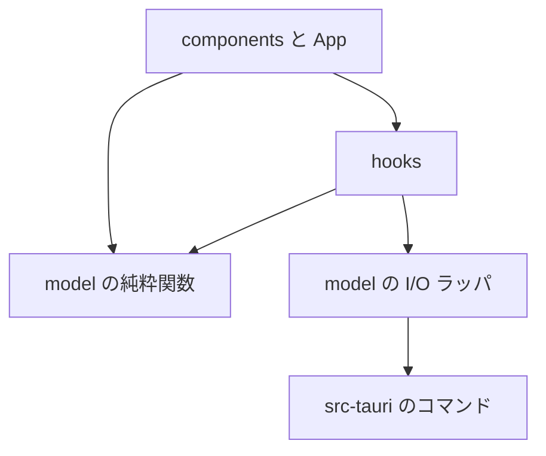
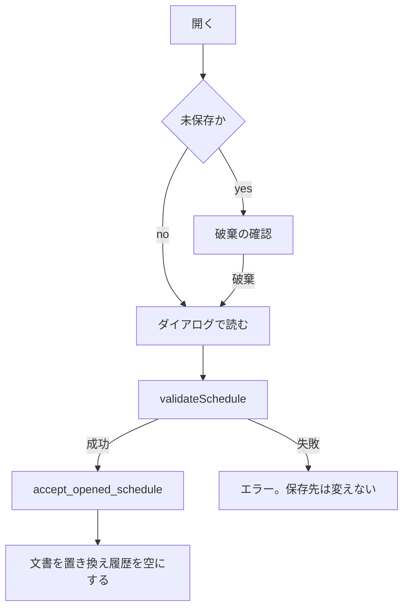
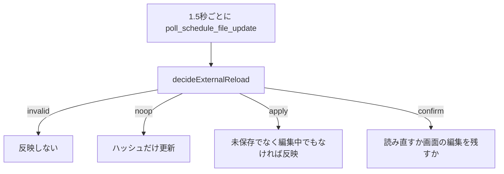

# 内部仕様

開発者が構成と処理の流れを追うための文書である。正本はソースコードで、この文書と食い違ったときはコードに合わせる。画面の挙動は [外部仕様](external-spec.md)、ファイルの形は [データ仕様](data-format.md) にある。

## 全体構成

画面は React で、時間軸は react-konva で描く。ファイルの読み書きは Tauri の Rust 側が行う。Rust は JSON の意味を解釈しない。検証、行の計算、取り消し履歴、書き出すファイルの生成は、フロントの `src/model/` にある。

| 場所 | 責務 |
| --- | --- |
| `src/main.tsx` | React のマウント |
| `src/App.tsx` | 画面の組み立て、ダイアログの接続、右クリックメニュー。キーボードは `useAppKeyboard` |
| `src/components/` | ツールバー、サイドバー、タイムライン、各ダイアログ |
| `src/hooks/` | 文書（スケジュールの内容）、ファイル、ズーム、今日、メンバー、カレンダーの状態 |
| `src/model/` | 型、検証、行、座標、履歴、書き出し。I/O を持つのは一部だけ |
| `src/sample/` | 起動時のサンプル |
| `src-tauri/src/lib.rs` | ダイアログ、一時ファイルを使った安全な置き換え、アプリデータ、内容ハッシュ、MCP 待ち受け |
| `src-tauri/src/mcp_stdio.rs` | `--mcp` 起動の標準入出力 JSON-RPC（`initialize`、`tools/list`、`tools/call`） |
| `src-tauri/src/mcp_bridge.rs` | アプリデータのローカルソケットと、送り先 webview への `mcp-screen-request`。`open_windows` は Rust だけで一覧を返す |
| `src-tauri/src/mcp_app_data.rs` | Tauri を起動せずにアプリデータディレクトリと `mcp.sock` のパスを決める。Windows の名前付きパイプ名も組み立てる |
| `src-tauri/src/mcp_bridge_windows.rs` | Windows の名前付きパイプ待ち受けと `--mcp` からの接続 |
| `scripts/` | 検証器の生成、サンプル検査、バージョン同期、操作マニュアルの GitHub Pages 用サイトビルド |
| `docs/*.schema.json` | JSON Schema の正本 |
| `.cursor/skills/` | LLM 用のスキル。`implement-change` はこのリポジトリの実装手順、`review-project` は全体レビュー、`review-implementation` は計画を実装したあとのレビューの手順。`update-schedule-schema` はスケジュール JSON の形を変えるとき。`write-schedule`、`write-members`、`write-calendar`、`write-workspace` は他のリポジトリへコピーして使う |

依存は上の図の向きだけである。コンポーネントは、モデルの純粋関数を直接呼ぶことがある。`model` はコンポーネントを参照しない。

## モジュール一覧

### コンポーネント

| ファイル | 役割 |
| --- | --- |
| `AppMenu.tsx` | ☰ メニュー |
| `ContextMenu.tsx` | タスク、マイルストン、左のマイルストングループ名の行、カテゴリ、グループ、チャートの空きの右クリックメニュー。区切り、危険色の削除、Lucide アイコン、ショートカット表示。タスクは編集、複製、確度、ノート、系統、削除。マイルストングループ行は非表示と、条件付きのこの行だけ表示。カテゴリは名前の変更、下へのカテゴリ追加、グループ追加、条件付きの削除。グループは名前の変更、下へのグループ追加、条件付きの削除。マイルストンは編集、確度の切り替え、削除。日付ヘッダー、マイルストン帯の空き、チャート本体の空きは「マイルストンを追加」だけ。`#root` に出す。位置はクリック座標と `offsetWidth` / `offsetHeight` から `anchoredMenu.ts` の `menuShiftForRect` で一度だけ決める |
| `TaskDetailPanel.tsx` | 選択が1件のときの右パネル。`applyTaskPatch` で項目ごとに履歴。フォーカス中は外部反映を止める。保存は呼び出し時点の文書を土台に、利用者が変えた項目だけ上書きする。開始日と終了日は日付欄を変えたときだけ含める |
| `BulkTaskDetailPanel.tsx` | 選択が2件以上のときの右パネル。共通値の表示と下書き。「件数に適用」で `applyBulkTaskDraft` を一度だけ呼ぶ。下書きがあるあいだは外部反映を止める |
| `MilestoneField.tsx` | 詳細パネルとタスク複製ダイアログの「対応マイルストン」。`milestoneField.ts` で候補と強調行を組み立てる |
| `DiffStrip.tsx` | チャート右の差分列。畳んだ取っ手と、開いた変更の一覧。空の結果だけ閉じる |
| `StatusBar.tsx` | 画面下端。未保存のクリックで差分列を開く |
| `Toolbar.tsx` | `ScheduleToolbarTitle`、検索、絞り込みパネル、系統、線を引く、追加、マイルストン追加、削除、取り消し、やり直し、今日と日・週・月・全体、操作の案内、ショートカット一覧 |
| `ScheduleToolbarTitle.tsx` | 見出しのタイトル表示、鉛筆による EDIT-20 のその場編集、鉛筆の右の EDIT-21「階層編集」入口。パレットの要求番号だけで編集を始める |
| `HierarchyLevelsDialog.tsx` | EDIT-21。段ごとの名前・意味・指示、見出し段の上下と削除、段の追加、不一致時の alert、閉じるで `useSchedule.commitLevelDefinitions` |
| `ActiveFilterBar.tsx` | 効いている絞り込みと系統の札 |
| `FilterPanel.tsx` | 絞り込みの選択欄。タグとマイルストンは候補を絞る入力欄 |
| `GuideDialog.tsx` | 操作の案内（`guideContent.ts` の文） |
| `ShortcutsDialog.tsx` | ショートカット一覧 |
| `CommandPalette.tsx` | ⌘/Ctrl+K のコマンドパレット |
| `Sidebar.tsx` | 左の行、階層の細い縦線（`hierarchyGuide.ts` が見えている行から本数を決める）、マイルストングループ名の行の右クリック、折りたたみ、切れた名前の全文、タスク行のクリック選択とホバー帯、左端の握りによる並べ替えと別グループへの移動、グループ行の握りによる並べ替えと別カテゴリへの移動、カテゴリ行の握りによる並べ替え、並べ替え中にポインタへ付く半透明の行または塊 |
| `Timeline.tsx` | Konva のヘッダー、バー、前後の線、イナズマ線、ドラッグでのスクロール。ポインターの当たりは `useTimelinePointer` |
| `MilestoneBand.tsx` | マイルストンのひし形 |
| `*Dialog.tsx` | [外部仕様](external-spec.md#ダイアログ) の各ダイアログ |
| `ModalDialog.tsx` | 共通の枠。Escape、フォーカスの保持、背面の操作禁止。`#root` の `inert` は `useLayoutEffect` で付け外しし、閉じたあとの描画の前に外す |
| `TaskNoteButton.tsx` | ノートの有無で色を分けるボタン |

### フック

どれも React の状態か副作用を持つ。

| フック | 持つもの |
| --- | --- |
| `useSchedule` | 文書、取り消し、絞り込み、選択（`taskSelection` の id 配列と `anchorId` / `activeId`。履歴に入れない）、折りたたみ、系統、編集対象、複製元、一括下書き、タスクとカテゴリの並べ替えのプレビュー |
| `useMacOSAppMenu` | macOS のデスクトップ版だけ、画面上部のアプリメニューを組み立てる |
| `useScheduleFile` | パス、未保存の基準、開く、履歴から開く、ドロップで開く、閉じる確認。保存、控え、外部更新、起動復旧は `src/hooks/scheduleFile/` に分け、戻り値はここがまとめる |
| `useRecentFiles` | `recent-files.json` の読み直しと消去。ウィンドウが前面になったときも読み直す |
| `useAppKeyboard` | ウィンドウのキー。押した結果の判断は `appKeyboard.ts` |
| `useTimelinePointer` | チャートとマイルストン帯のホバー、線を引くときの追随。当たりは `chartHitTest.ts` |
| `useTimelineView` | 1日あたりの幅、スクロール、ホイール。キーの `scrollBy` は `useAppKeyboard` から呼ぶ |
| `useToday` | 今日の日付。日付が変わると更新する |
| `useMemberCatalog` | カタログの読み込みと選択 |
| `useStatusCatalog` | ステータス一覧の読み込みと選択。無いときは組み込みの三件 |
| `useAppCalendar` | カレンダーの読み込み |
| `useMcpScreenBridge` | デスクトップ版だけ。自ウィンドウ宛の `mcp-screen-request` だけを受け、読み取り 6 ツールを組み立てる（`current_schedule` は `scheduleCurrentJson` を返す。`window` は橋渡しで外れる。文書の `levels` を `screenContext` に渡す）。`replace_schedule` は `replaceSchedule.ts` で門（起動未完了・起動復旧ダイアログ・操作中）と引数を検証し、`assessReplaceScheduleLevelCount` で渡した JSON の段数と入れ子を見てから `useSchedule.replaceScheduleDocument` で履歴付き置き換えのあと `scheduleDiffLoad` で差分テキストを返す。編集拒否は `isError`、保存形式が同じときは差分だけ成功 |

### モデル

純粋関数が大半である。副作用があるのは、`scheduleFile.ts`、`memberAppData.ts`、`statusAppData.ts`、`calendarAppData.ts`、`exportHtml.ts` の保存、`uiScale.ts` と `colorScheme.ts` と `sidebarWidth.ts` の localStorage だけである。

| 関心 | ファイル |
| --- | --- |
| 型 | `types.ts`、`memberTypes.ts`、`calendarTypes.ts` |
| 検証 | `validateSchedule.ts`、`validateMembers.ts`、`validateCalendar.ts`、`*Semantics.ts`、`scheduleMigrate.ts`、`uuidV5.ts`、`validationMessages.ts`、`generated/` |
| 行と前後関係 | `rows.ts`、`stickyRows.ts`、`dependencies.ts`、`summary.ts`、`progressRollup.ts`、`tasks.ts`、`taskOrder.ts`、`categoryOrder.ts`、`groupOrder.ts` |
| 時間軸 | `timeline.ts`、`timelineVisibleDays.ts`、`dates.ts`、`monthHeader.ts`、`nonWorkingDay.ts`、`milestones.ts`、`chartHitTest.ts` |
| 担当とノート | `assigneeDisplay.ts`、`taskNote.ts` |
| 対応マイルストン欄と絞り込みのマイルストン欄 | `milestoneField.ts` の `buildMilestoneFieldList`、`buildMilestoneFilterList`、`initialMilestoneFieldActiveIndex`、`initialMilestoneFilterActiveIndex` |
| 履歴と保存形式 | `history.ts`、`serialize.ts` |
| 画面と開いているファイルの差分 | `scheduleDiff.ts`、`scheduleDiffEntry.ts`、`diffNavigation.ts`、`scheduleDiffLoad.ts`、`diffStripVisibility.ts` |
| 起点・画面・ファイルの差分と分類 | `baselineDiffs.ts`、`baselineDiffsOutline.ts`（`levels` と `outline` の分類と合成）、`baselineDiffsLoad.ts` |
| 外部更新時の非衝突合成と判定 | `baselineMerge.ts`（`assessBaselineMerge`、`buildNonConflictingMergedDocument` は `baselineDiffs.ts`。合成の検証は `documentToJson`） |
| 外部更新確認の一覧表示 | `baselineMergeReview.ts`（`buildBaselineMergeReview`） |
| 反映の取り消しで帯を戻す判定 | `baselineMergeDeferred.ts` |
| MCP 用の画面スナップショット | `screenContext.ts`（`filtered_tasks` / `selected_task` / `selected_tasks` / `current_schedule`。タスク系の応答の先頭は `levels`、続けて `statuses`）、`hierarchyLevelEdit.ts`（階層ダイアログの確定、保存前の `assessHierarchySave`、`replace_schedule` 前の `assessReplaceScheduleLevelCount`）、`scheduleDiffLoad.ts`（`schedule_diff`）、`baselineDiffsLoad.ts`（`baseline_diffs`）、`replaceSchedule.ts`（`replace_schedule` の門と差分上限）、`mcpRegistration.ts` |
| 絞り込みで残るタスクの列挙 | `rows.ts` の `listTasksMatchingFilter` |
| ファイルの入出力と、外部更新・控えの判定 | `scheduleExternalReload.ts`、`scheduleRecovery.ts`、`scheduleFile.ts` |
| 最近開いたファイルの一覧とメニュー文言 | `recentFiles.ts` |
| アプリデータ | `memberAppData.ts`、`statusAppData.ts`、`calendarAppData.ts` |
| 書き出し | `exportHtml.ts`、`exportExcel.ts`、`exportView.ts`、`exportFilename.ts` |
| 見た目の寸法と配色 | `layoutSizes.ts`、`uiScale.ts`、`sidebarWidth.ts`、`colorScheme.ts`、`palette.ts` |
| キーボードショートカット | `shortcuts.ts` |
| 操作の案内の文 | `guideContent.ts` |

## 状態

状態は3種類に分かれる。

| 種類 | 中身 | 置く場所 | 残るか |
| --- | --- | --- | --- |
| 文書（`ScheduleDocument`） | タイトル、カテゴリ、マイルストングループ、マイルストン、任意の `levels` と `outline` | `useSchedule` | ファイルと控えだけ。取り消しはメモリ |
| 表示 | 絞り込み、帯の線の表示、選択、折りたたみ、系統、線を引くモード、ズーム、スクロール | `useSchedule`、`App.tsx`、`useTimelineView` | 絞り込み、帯の線、折りたたみはデスクトップ版でパスごとに `schedule-filters/`。☰ の「開く」と新しいウィンドウでは初期化。系統、選択、ズーム、スクロールは残さない。開いた直後はズームと一覧の縦位置を先頭へ戻す |
| ファイル | パス、未保存判定の基準にする JSON、ディスクのハッシュ | `useScheduleFile` と Rust の `ScheduleFileStates`（ウィンドウラベルごと） | ウィンドウ一覧は `open-windows.json`。未保存の控えはパスごとに `schedule-recovery/`。絞り込みはパスごとに `schedule-filters/` |

取り消しのスナップショットに入るのは `title`、`categories`、`milestoneGroups`、`milestones`、`levels`、`outline` である。絞り込みなどの表示状態は履歴に入らない。`history.ts` は、内容が同じ変更を積まず、最大 100 件で古いものから捨てる。比較は保存形式の文字列で行い、現在の文書のキーを覚えているので、次の文書だけを文字列化する。文書を変える操作は、確定したときに 1 ステップだけ積む。失敗した変更は積まない。マイルストンを消して絞り込みを「すべて」に戻すことは表示状態で、その戻りは履歴に入らない。編集で別のマイルストングループへ移し、移した先の帯の線がオフだったときにそのグループだけオンに戻すことも表示状態で、履歴に入らない。線を引くモードの起点は表示状態で、選択が起点と違う値になったときモードは終わる。

表示の状態のうち、表示サイズ、配色、左一覧の基準幅、自動更新のオンオフは localStorage に残る。キーの一覧は [データ仕様](data-format.md#アプリデータ) にある。デスクトップ版では、同じオリジンの `storage` イベントと、メンバー・カレンダー変更時の revision イベントで、他のウィンドウが設定を読み直す。行の密度、イナズマ線、一覧の列も localStorage のままアプリで一つである。画面に反映する解決済みの配色（ライトかダーク）は React の状態で持ち、システム追従のときは `prefers-color-scheme` の変化を監視する。左一覧の幅は、希望の基準幅と、チャートが 200px を下回らないよう縮めた表示幅を分ける。ウィンドウを狭めたときは表示だけ縮め、希望幅は残す。

## 主な処理の流れ

### 開く

開く成功のあと、デスクトップ版だけ `record_recent_files` で `recent-files.json` を更新する。スケジュールと設定ファイルは別配列である。起動時に前回のウィンドウを載せるとき、前面化だけのとき、`replace_schedule` では足さない。履歴から開くときも `runOpenFromPath` と `applyOpenedFile` の既存経路を使う。設定ファイルは `classifyOpenedJson` で開き分け、`accept_opened_workspace` で `open-windows.json` に `workspacePath` を書き、`loadWorkspaceBinding` が相対パス先を読む。表示は `useWorkspaceBinding` と `App.tsx` の `displayMembers` / `displayStatuses` / `displayCalendar` が束縛を優先する。`export_workspace_bundle` がフォルダ書き出しを行う。

ブラウザ版はダイアログの代わりにファイル選択を使い、`accept_opened_schedule` は呼ばない。

FILE-08 はデスクトップ版だけが Tauri の `DragDrop` を受け、`useScheduleDropOpen` が `classifyDroppedSchedulePaths` と `scheduleDropBlockedReason` で仕分けと門を見る。門はファイル操作の確認ダイアログと、その時点で開いている `role="dialog"` も見る。1件の `.json` は `read_dropped_schedule_file` で読み、検証後に `accept_opened_schedule` と `replaceDocument` の既存経路で開く。WIN-04 は `schedule_drop.rs` が起動引数、macOS の `RunEvent::Opened`、`tauri-plugin-single-instance` の引数を `ExternalDropQueue` に載せる。`Opened` は macOS の `cfg` の中だけで参照する。2つ目のプロセスの引数は先頭の実行ファイルを除き、フォルダは件数に残す。キュー内の同じ束だけ重複を捨てる。全ウィンドウの起動復旧が `report_startup_settled` で揃い、復旧の確認ダイアログを閉じたあと `report_external_schedule_drop_ready` で揃ったときだけ `schedule-external-drop` を前面ウィンドウへ送る。待ちのあいだは拒否文を出さず、キューも進めない。ルートは `routeExternalScheduleDrop` が決め、同じ正規化パスなら `focus_schedule_window`、パス無し1枚ならそのウィンドウで開く、それ以外は `create_schedule_window` または `forward_schedule_external_drop` である。`ack_external_schedule_drop` は配りを受けたウィンドウだけが送る。ブラウザ版は `main.tsx` が `dragover` と `drop` で `preventDefault` するだけである。

### 保存

`save_schedule_file` は、上書きのとき開いているパスと要求パスが一致することを見る。パスが無いときは、フロントが別名保存として保存ダイアログを開く。`skip_disk_hash_check` が無いときは、記憶している SHA-256 とディスクを比べ、違えば `DISK_HASH_MISMATCH` を返す。フロントはこのとき SYNC-02 の確認を出す。確認の待ち時間にも保存は一つだけである。この直列化は `useScheduleSave` が持つ。保存の前に `hierarchyLevelEdit.ts` の `assessHierarchySave` が、`levels` があるとき入れ子の深さと段数を見る。一致しないときはファイルを書かず、外部仕様の文言で知らせる。書き込みは一時ファイルへ書いてから置き換える。

### 外部更新

判断は `scheduleExternalReload.ts` の純粋関数である。自分の保存のあとは `acknowledge_schedule_file_contents` でハッシュを更新し、直後の監視を外部更新とみなさない。監視の開始、停止、5回連続の読み取り失敗は `useScheduleExternalReload` が持つ。ファイル操作中と保存の確認中は、読んだ内容を反映しない。監視は、ロック中にパスと期待ハッシュだけを取り、ファイルの読み込みとハッシュ計算はロックの外で行う。読み終わったときにパスが違っていたら、その結果は使わずにもう一度読む。未保存の確認では `assessBaselineMerge` で分類し、衝突が無いときは `useSchedule` の `applyMergedDocument` が履歴付きで画面へ置く。編集中の判定には、階層の編集ダイアログ（`hierarchyLevelsOpen`）も含める。読み直しと「両方を画面へ反映」の前に、そのダイアログは確定せず閉じる。取り消しで反映の直前の文書に戻ったときだけ、`baselineMergeDeferred.ts` の判定で保留のディスク内容を状態バーへ戻す。やり直しで反映の直後の文書に進んだときだけ帯を消す。起点が変わったあとは、覚えていたディスク内容を捨てる。

### 差分

「差分を表示」は、画面の保存形式と、`read_open_schedule_file` で読んだ開いているファイルを `formatScheduleDiff` に渡す。カテゴリ、グループ、タスク、マイルストンは id で対応づける。グループは、別のカテゴリへ移っていても同じ id なら変更である。`collectScheduleDiffEntries` は同じブロックに移動先を付け、一覧の行を押したときの寄せ先は `diffNavigation.ts` が決める。結果はチャート右の差分列の一覧に出す。コピー用の全文は `formatScheduleDiff` の文字列のままである。未保存で差があるあいだは、列は畳み、右端の取っ手だけ出す。☰ の「差分を表示」と状態バーの「未保存」は列を開く。列の開閉は `App` の `diffPanelExpanded` で持ち、ファイルには書かない。列が消えたら開閉も忘れる。開いたあとの自動読み直しは開いたまま、畳んだあとは畳んだまま、一覧だけ更新する。一覧にフォーカスがあるあいだは、`appKeyboard.ts` の `decideAppKey` がガント向けのキーを止める。一覧の札と名前と場所は `collectScheduleDiffEntries` がブロックごとに付ける。縦の寄せは `scrollYToShowSelectedTask` を使い、見えている行では `scrollY` を変えない。マイルストンの印は `diffNavigationMark.chartMilestoneId` を `MilestoneBand` が、帯の行の印は `diffNavigationMark.milestoneGroupId` を `Sidebar` が描く。寄せた行の印は `App` の `diffNavigationMark` で持ち、タスクの選択とは別である。パスが無い、またはブラウザ版のときはファイルを読まず、「比べるファイルがありません」と列に出す。検証に失敗したときは列に書かず、☰、「未保存」、コピーキーでは読み込みエラーを出す。⌘ または Ctrl+Shift+D は列を開かず全文を写す。自動の読み直しで失敗したときはエラーダイアログを出さない。読んだ内容は保存しない。`content_hash` は変えない。

### 前回のファイルと控え

開く成功と保存の成功で、ウィンドウ一覧とそのウィンドウのパスを `open-windows.json` に書く。前面のウィンドウのラベルも更新する。未保存でパスがあるとき、そのパスの前面のウィンドウだけが、変更から約1秒後に `write_schedule_recovery` を呼ぶ。前面が保存済みなら、そのパスの控えは消す。終了で閉じ始める直前の前面を、その終了の控えの書き手として固定する。控えはパスごとに `schedule-recovery/<ハッシュ>.json` へ書く。後ろのウィンドウからの書き込みと削除は、Rust が捨てる。

絞り込みは `useScheduleFilterPersistence` が、前面のウィンドウだけから約1秒後に `write_schedule_filter` を呼ぶ。初期値なら `delete_schedule_filter` する。閉じるときと終了・更新前の控えの書き込みと同じタイミングで、待たずに書く。書き手の決め方は控えと同じ `recovery_live_action` と `recovery_close_action` で、未保存の代わりに初期値でないかを渡す。起動で文書を載せたあと、`read_schedule_filter` で読み、`scheduleFilterPersistence.ts` で検証して `useSchedule` の表示状態へ入れる。戻すときに無くなった参照を外すのは、いま載せた文書のカテゴリ、グループ、マイルストン、マイルストングループを使う。React の state がまだ前の文書のとき、画面の `pruneContext` だけに頼らない。メンバー一覧の初回読み込みが終わるまで、戻す処理では担当者を外さない。編集中にカテゴリやグループを消したあとも、折りたたみの id は画面の集合からは外さない。次回起動の戻しだけ、文書に無い id を外す。書き込みを止めているあいだに戻した組は、その組をそのまま書く。`replaceDocument` が初期値に戻した直後の `getFilterViewState` で消さない。メンバー一覧の初回読み込みが終わるまで、担当者の参照を外す effect は動かない。パスを替えたときは `release_schedule_filter` で後始末する。

起動時の判断と画面への反映は `useScheduleStartupRecovery`、控えの書き込みと削除は `useScheduleRecoveryDraft` が行う。起動時は `read_window_startup` が、ウィンドウごとのパス、控え、サンプルかを返す。追加ウィンドウは、その前に `take_pending_schedule_window_open` の内容を載せる。古い `last-schedule.json` と `schedule-recovery.json` は `window_session.rs` が初回に移す。読めなかった古い控えは残し、`open-windows.json` はまだ作らない。`decideRecoveryStartup` が、保存済みで開く、未保存の復元、競合、ファイル無し、不正を返す。ファイルが無く未保存があるときは、先にその内容を画面へ載せてから警告する。この起動でファイル無しを知らせたあとは、そのパスが再び読めるまで監視のファイルダイアログを出さない。`read_schedule_file_at_path` は、控えがあるパスと一致するファイルだけを読む。起動復旧が終わるまでだけ、文書の変更、取り消し、やり直しは受け付けない。終わったあとは受け付ける。開き終わる前にディスクが変わっていれば、開いたあと通常の外部更新として読む。ファイルの書き込みは止めない。画面へ載せる前に、パスも未保存も無いかを見てから `accept_opened_schedule` する。そのあと起動の世代が変わっていたら、文書は置き換えない。

### 別ウィンドウ

デスクトップ版の自動更新は `tauri-plugin-updater` と `tauri-plugin-process` が担う。エンドポイントと公開鍵は [src-tauri/tauri.conf.json](../src-tauri/tauri.conf.json) の `plugins.updater` に置く。確認先は入っている版のメジャー `X` 用の `updater-X` Release が載せる `latest.json` 1 件である。`npm run version:bump` は [scripts/project-version-files.ts](../scripts/project-version-files.ts) が同じ URL を書く。起動時にオンだったかは `readAutoUpdateEnabled`（`src/model/autoUpdate.ts`）が起動直後に一度だけ読む。`useAppUpdateFlow`（`src/hooks/useAppAutoUpdate.ts`）が、起動復旧のあと `report_startup_settled` で各ウィンドウの起動時のオンオフを渡し、開いているウィンドウがすべて揃ったときだけ一度だけ `check` する。ウィンドウが閉じて揃いが変わったときも同じ判断をもう一度行う。受け取ったウィンドウだけが `check` で新しい版を調べ、`Update` オブジェクトはそのウィンドウの JS に残る。`shouldAcceptAutoUpdate` が、同じメジャーのより新しい安定版だけを入れ直し対象にする。外れるときは `Update.close` して終わり、知らせは出さない。起動時の失敗表示は `shouldIgnoreUpdateCheckError` が、更新なしと同様の失敗を出さない。手動確認の文言分けは `classifyUpdateCheckError` が担う。入れ直す版があるときは `sync_application_update_ui` と `application-update-ui-sync` で全ウィンドウの UI 状態を揃え、前面ウィンドウの隅または設定の「更新」欄に知らせを出す。ユーザーが「入れ直す」を選んだあとだけ `request_application_update` が全ウィンドウへ `application-update-requested` を送る。サンプルの未保存は破棄確認を出し、確定かキャンセルを待ってから `accept_application_update` する。すべて揃ったあと、終了と同じくパスごとの控えの書き手を固定し、全ウィンドウへ `application-update-write-recovery` を送って控えを書く。書き終えたあと、`check` したウィンドウラベルへ `application-update-proceed` を送り、そのウィンドウだけが `downloadAndInstall` して `relaunch` する。持つウィンドウを閉じたあとに「入れ直す」を押したときは、残ったウィンドウがもう一度 `check` する。再起動で閉じるときは破棄確認を出さない。`downloadAndInstall` が処理を戻して失敗したときは、失敗の知らせだけを出す。背面のときの OS 通知は `show_application_update_background_notification` が、既存の peer 通知と同じ経路で1回出す。ベータのインストーラ保存は、フロントの `pickSaveableBetaVersion`（`src/model/betaRelease.ts`）が GitHub API で取ったタグから版を選び、`fetch_beta_release_tags` と `save_beta_installer`（`src-tauri/src/beta_installer.rs`）が一覧取得、保存ダイアログ、ダウンロードを行う。アップデータの `check` も `downloadAndInstall` も使わない。安定版の Release 用の署名付き `latest.json` は CI が各 Release に添付する。同じメジャー用の `updater-X` は Pre-release で、`latest.json` だけを載せる。[scripts/prepare-stable-github-release.ts](../scripts/prepare-stable-github-release.ts) が安定版の GitHub Release をビルド前に作る。タグの対象は `GITHUB_SHA` である。より大きいメジャーの安定版があるときは Latest を外す。[scripts/publish-updater-channel.ts](../scripts/publish-updater-channel.ts) が `shouldUpdateUpdaterChannel` で `updater-X` を上書きする。既存の `updater-X` で `latest.json` の `version` が読めないときは失敗する。[scripts/finalize-stable-github-release-latest.ts](../scripts/finalize-stable-github-release-latest.ts) が、資産と `updater-X` の更新のあと、`shouldMarkGitHubReleaseLatest` が true のときだけ Latest を付ける。設定の「更新」は [src/components/SettingsChangelogHistory.tsx](../src/components/SettingsChangelogHistory.tsx) が、同梱の `CHANGELOG.md` を `parseBundledChangelogVersions` で読んで欄内に出す。起動時には出さない。

設定ダイアログの下に出す今の版は、デスクトップ版では `@tauri-apps/api/app` の `getVersion`（権限 `core:app:allow-version`）を、ブラウザ版では `package.json` の `version` を、設定を初めて開いたときに 1 回だけ読む。整形した 1 行は [src/components/SettingsDialog.tsx](../src/components/SettingsDialog.tsx) のモジュール内に残し、閉じたあとも取り直さない。新しい Tauri 命令は足さない。

`create_schedule_window` は async コマンドで、検証済みの内容を pending に載せたあと `run_on_main_thread` で WebView を作り、成功したあとだけ `open-windows.json` に足す。呼び出し元がメインスレッドのときは、作成の待ちを別スレッドで行う。作れなかったときは pending だけ戻す。起動時の追加分は `spawn_startup_windows` が同じビルダーで作る。記録に `main` が無く他のラベルだけがあるときは、設定で作った空の `main` を起動直後に閉じる。複数ウィンドウのうち1枚を閉じたあと、別のウィンドウが残るときは `unregister_window_session` と `WindowEvent::Destroyed` のどちらかで一覧からそのラベルを外す。前面ラベルはウィンドウの `Focused` と `register_window_focus` で更新し、起動時にフロントが無条件で前面を書くことはしない。新しいウィンドウは起動復旧より先に `take_pending_schedule_window_open` で内容を受け取る。`emit_schedule_peer_notice` が他ウィンドウへ `schedule-peer-notice` を送る。どのウィンドウも前面に無いときは、同じ内容の OS 通知を1回出す。Linux では通知のクリックで対象ウィンドウを前面にする。`useSchedulePeerNotice` が隅の知らせを出し、「反映した」は数秒で消す。`focus_schedule_window` で前面化する。終了は `request_application_quit` が全ウィンドウへ確認を送り、すべてが受け入れてから閉じる。キャンセルしたときは閉じない。最後のウィンドウを閉じるときと終了時は、`open-windows.json` からその記録を外さない。2つ目のプロセスは `tauri-plugin-single-instance` で既存のアプリを前面に出し、スケジュール用のパス引数があれば `ExternalDropQueue` に載せる。引数が `--mcp` だけ、または `--screen` とツール名だけの起動は `main` で分岐し、この処理には含めない。macOS の `RunEvent::Opened` も同じキューへ入れ、同一バッチの重複は捨てる。

起動時の `setup` は、`mcp_app_data::migrate_legacy_app_data_if_needed` で旧 identifier のアプリデータを移してから `app_data_dir` を使う。Microsoft Store の MSIX かどうかは [src-tauri/src/store_distribution.rs](../src-tauri/src/store_distribution.rs) の `is_store_distribution`（Tauri 命令 `is_store_distribution`）で見る。Store 版では起動時の自動更新確認を Rust 側で始めない。

MCP の `--mcp` プロセスは標準入出力だけを話し、`tools/call` をローカル待ち受けへ送る。Unix はアプリデータの `mcp.sock`（所有者のみ）。Windows は `\\.\pipe\io.github.shkobayashi.schedule-viewer-<SID>` の名前付きパイプで、アプリデータにファイルは置かない。パイプのセキュリティ記述子は待ち受けスレッドの中で作る。応答を書いたあと、クライアントが接続を閉じるまで待ってからパイプを切る。使用中の接続があるときは、クライアントは応答待ちと同じ 5 秒まで接続を試し直す。待ち受けが次のパイプを作るあいだに名前が消えても、その秒数まではウィンドウが無い旨にしない。待ち受けの 1 回の失敗ではスレッドを終えず、短い待ちのあと次のパイプを作る。GUI は `setup` で待ち受けを始める。`open_windows` は `window_session::build_mcp_open_windows_list` で生きている webview の一覧だけを返し、webview へ回さない。それ以外の読み取りは、`window` 引数が無いとき記録の前面、OS の前面、直近の前面順の順でラベルを決め、あるときはそのラベルの生きている webview へ `mcp-screen-request` を送る。読み取り 6 つだけ、webview へ渡す直前に `window` を引数から外す。`replace_schedule` の引数に `window` キーがあるときは webview へ送らず失敗する。各ウィンドウは自ラベルのイベントだけを受ける。応答は `mcp_reply` で返す。送り先と違うウィンドウの応答は pending を外さず捨てる。応答待ちを過ぎた相関 id は pending から外し、遅れた `mcp_reply` は捨てる。ウィンドウごとの世代番号でも遅れた応答を捨てる。読み取り 6 ツールはフロントの `taskMatchesFilter`、`formatScheduleDiff` など既存の純粋関数だけで組み立て、`current_schedule` は `scheduleCurrentJson` を返し、画面とファイルは変えない。`replace_schedule` は `replaceSchedule.ts` と `useSchedule.replaceScheduleDocument` で前面の文書だけを変え、ファイルには書かない。`--screen` は `screen_cli.rs` が `--screen <tool>` または読み取り 6 つに `--window <label>` を解析する。`--screen replace_schedule` は標準入力の JSON を読み、10MB を超えたら待ち受けへ送らない。Store 版の `get_executable_path` と read-screen スキルは `schedule-viewer.exe` の実行エイリアスを書き、WindowsApps 配下の絶対パスは書かない。

保存は、外部更新の確認を待つあいだも一つの処理だけが進む。確認を出して戻ったあとに、上書きや別名保存を続ける。

### 書き出し

`exportView.ts` が見える行からマイルストンと期間を決める。画面の前後の線と Excel の先行列の名前は、`hierarchy.ts` の `collectTasksFromDocument` で文書（`categories` または `outline`）から集めたタスクを使い、`dependencies.ts` の `visibleLinksFromTasks` が見えている行のリンクを決める。HTML と SVG は `exportHtml.ts` が組み立て、デスクトップ版は `save_html_file`、ブラウザ版はダウンロードである。Excel は `excelExportColumns.ts` が左の列の選び方を localStorage で持ち、`exportExcel.ts` がペイロードを組み立てる。日付列は `excelTimeColumns.ts`、シートの休日色と罫線色は `excelSheetColors.ts`、日付列の縦罫線の色は `excelDateColumnBorder.ts`、タスクバーの位置と色は `excelBar.ts`、親バーの区間・点線・角は `excelSummaryBar.ts`、前後の種類と色と折れ位置は `excelConnector.ts`、イナズマ線は `excelLightning.ts`、マイルストンの日付セルの文字列とグループ名は `excelMilestone.ts` が決める。行ごとの名前の字下げ・太さ・文字色と、一番上の見出し行の左列だけの塗りは payload の `rows` に載せる。`exportExcel.ts` は見出しを進めながら、直後のタスクの字下げをその見出しの字下げより 1 深くする。1段だけのときは見出しが無く、タスクの字下げは 0 である。`exportHtml.ts` の `exportHierarchyHeadingIndent` と `exportHierarchyHeadingKind` が階層見出しの字下げと Excel の行種別を決め、`exportChartRowFill` が HTML と SVG のチャート側の行の地を左一覧と揃える。本文の行高と日付列の幅は payload の `bodyRowHeightPx` と `dateColumnWidthPx` に載せ、見出し行の高さは `headerRowHeightPx` に載せる（日付列が 96px 以上なら 28、未満なら 22。本文の `bodyRowHeightPx` とは別である）。週・月のバーと線は等幅の列のうち期間に対する割合で置く。前後は payload の `connectors` に載せ、先行バー図形の右中央（接続点 3）から後続バー図形の左中央（接続点 1）へ、カギ線または直線の矢印コネクタでつなぐ。イナズマ線は payload の `todayLine` で、本文の上端から下端までの縦線 1 本を線の幅で描く。`export_xlsx.rs` が `rust_xlsxwriter` でブックとタスクバーなどのテキストボックスを作り、列幅と先頭文・マイルストン行の結合（罫線なし）、見出しと本文の左の表の罫線と日付列の縦罫線、日表示の休日の日付セルの塗り、カテゴリ行の左列だけの塗りを書く。画面の格子は出さない。図形の幅と高さは、5px 未満の辺を 5px に繰り上げてから渡す。それ未満を渡すとライブラリは既定の 192×120 になる。コネクタ、今日の縦線、親バーの点線と角は `excel_drawing_patch.rs` が `xl/drawings/drawing1.xml` に足す。親バーの点線と角の `twoCellAnchor` は、日付列の幅 `dateColumnWidthPx` で列を進めて終端を決める。追加図形の `cNvPr` の id は、ライブラリが書いた図形の id の次（`shapes.len() + 2` から）を使う。スナップの縦の通算は payload の `bodyRowHeightPx` を使う。コネクタの `twoCellAnchor` は、先行の右辺の中央と後続の左辺の中央を対角にした箱で、後続の位置に合わせて `flipH` と `flipV` を付ける。図形数の上限にはバー、コネクタ、今日の縦線、親バーの点線と角を合わせて数える。デスクトップ版だけ `save_excel_export` で保存する。書き出しの XML 契約は Rust のテストが実ブックを読んで確かめる。月表示の月ラベルの出し分けは `monthHeader.ts` と画面で共有する。

## 検証の流れ

配布ビルドの CSP には `unsafe-eval` が無い。Ajv でスキーマを実行時にコンパイルできないので、`scripts/compile-validators.mjs` がスキーマから、単体で動く検証コード（Ajv の standalone 出力）を `src/model/generated/` に作る。`dev`、`build`、`test` は先にこれを実行する。

スケジュールは次の順で見る。

1. schemaVersion 1 なら、終了日を1日戻して schemaVersion 2 にする
2. schemaVersion 2 は拒否する
3. schemaVersion 3 なら、確度が無いタスクに `committed` を足して schemaVersion 4 にする。既にある `confidence` はそのまま残す
4. schemaVersion 4 なら、カテゴリとグループへ名前から決まる UUID を付けて schemaVersion 5 にする。同じ内容なら ID は毎回同じである。タスクやマイルストンの ID とぶつかったときだけ別の ID にする
5. schemaVersion 5 のマイルストンに確度が無いときは `committed` を足す。既にある `confidence` はそのまま残す
6. schemaVersion 5 なら、マイルストンが1件以上あるときは名前「マイルストン」の `milestoneGroups` を1つ足し、全部のマイルストンに `groupId` を付けて schemaVersion 6 にする。その ID は名前から決まり、カテゴリ、グループ、タスク、マイルストンの ID とぶつかったときだけ別にする。マイルストンが0件なら `milestoneGroups` は空のままである
7. schemaVersion 6 なら schemaVersion 7 にする。タグは付けない
8. schemaVersion 7 なら schemaVersion 8 にする。`status` の値は変えない
9. JSON Schema（schemaVersion 8）
10. 意味規則（ID の重複、先行の実在、循環など、スキーマでは表せない規則）。ID はカテゴリ、グループ、タスク、マイルストン、マイルストングループを通して重複できない

メンバー、ステータス一覧、カレンダーも、JSON Schema のあとに意味規則を見る。ステータス一覧は `validateStatuses.ts` が見る。`validationMessages.ts` は、エラーの場所を示す JSON Pointer をカテゴリやタスクの名前に置き換えて、エラー文言を作る。

`write-schedule`、`write-calendar`、`write-members` に同梱する検証スクリプトは、`scripts/build-validate-skill.mjs` が同じ検証を1ファイルにまとめて作る。このスクリプトは、スキーマもスキルのフォルダへコピーする。CI は、その結果がコミット済みと一致するかを見る。手順は [開発ガイド](development.md#スキーマを変えるとき) にある。

## Tauri コマンド

実装は `src-tauri/src/lib.rs`、許可は `src-tauri/capabilities/default.json` と `src-tauri/permissions/` にある。

| コマンド | 引数と戻り値 | 失敗と上限 | permission | TS |
| --- | --- | --- | --- | --- |
| `open_schedule_file` | ダイアログ。任意の初期ディレクトリ。パスと本文、または取り消し | 10MB、UTF-8 | `open-schedule-file.toml` | `scheduleFile.ts` |
| `accept_opened_schedule` | パスと本文。状態を記録 | 10MB | 同上 | 同上 |
| `check_schedule_file_changed` | ディスクのハッシュが記憶と違うか | ファイルを開いていない | `check-schedule-file-changed.toml` | 同上 |
| `poll_schedule_file_update` | 変化したときだけ本文 | 同上 | `poll-schedule-file-update.toml` | 同上 |
| `read_open_schedule_file` | 引数なし。開いているパスの本文 | ファイルを開いていない、10MB、UTF-8 以外 | `read-open-schedule-file.toml` | 同上 |
| `acknowledge_schedule_file_contents` | 本文。ハッシュを更新 | ファイルを開いていない | `poll-schedule-file-update.toml` | 同上 |
| `save_schedule_file` | 本文、別名か、提案名、期待パス、ハッシュ確認を飛ばすか。保存したパス | 10MB、`DISK_HASH_MISMATCH`、パス不一致、拡張子 | `save-schedule-file.toml` | 同上 |
| `save_html_file` | 本文、提案名、拡張子 | 10MB | `save-html-file.toml` | `exportHtml.ts` |
| `save_excel_export` | 書き出し用 JSON、提案名。保存したパス | 10MB | `save-excel-export.toml` | `exportExcel.ts` |
| `get_members_settings` | カタログ一覧と選択中 ID | — | `members-app-data.toml` | `memberAppData.ts` |
| `read_member_catalog` | カタログ ID。本文 | 2MB | 同上 | 同上 |
| `import_member_catalog` | ID、本文、上書きするか | 2MB、重複 | 同上 | 同上 |
| `delete_member_catalog` | ID | — | 同上 | 同上 |
| `set_selected_member_catalog` | ID または無し | — | 同上 | 同上 |
| `get_statuses_settings` | 一覧の一覧と選択中 ID | — | `statuses-app-data.toml` | `statusAppData.ts` |
| `read_status_catalog` | 一覧 ID。本文 | 2MB | 同上 | 同上 |
| `import_status_catalog` | ID、本文、上書きするか | 2MB、重複 | 同上 | 同上 |
| `delete_status_catalog` | ID | — | 同上 | 同上 |
| `set_selected_status_catalog` | ID または無し | — | 同上 | 同上 |
| `claim_status_catalog_edit` | 一覧 ID または設定ファイルの `statuses` の絶対パス。取得できたか、他ウィンドウのラベル | — | `status-catalog-edit.toml` | `statusAppData.ts` |
| `release_status_catalog_edit` | 一覧 ID または無し（無しはこのウィンドウのすべて） | — | 同上 | 同上 |
| `save_statuses_json` | 本文、提案名。保存したパス | 2MB | 同上 | `statusAppData.ts` の `exportStatusesJson` |
| `write_statuses_at_path` | 絶対パス、本文、設定ファイルのパス。呼び出し元ウィンドウの設定ファイルと一致し、設定ファイルの `statuses` の実パスだけを上書き。同じ設定ファイルの他ウィンドウへ `workspace-reload` | 2MB、JSON のみ、パス不一致 | `write-statuses-at-path.toml` | `statusAppData.ts` の `writeStatusesAtPath` |
| `get_calendar_state` | 表示名 | — | `calendar-app-data.toml` | `calendarAppData.ts` |
| `read_app_calendar` | 本文 | 2MB | 同上 | 同上 |
| `import_app_calendar` | 表示名と本文 | 2MB | 同上 | 同上 |
| `delete_app_calendar` | なし | — | 同上 | 同上 |
| `read_schedule_recovery` | 任意のパス。無ければ呼び出し元ウィンドウのパスの控え | 10MB | `schedule-recovery.toml` | `scheduleFile.ts` |
| `write_schedule_recovery` | 本文（`path` を含む） | 10MB | 同上 | 同上 |
| `delete_schedule_recovery` | パス | — | 同上 | 同上 |
| `read_schedule_filter` | 任意のパス。無ければ呼び出し元ウィンドウのパスの絞り込み | 64KB | `schedule-filter.toml` | `scheduleFilterFile.ts` |
| `write_schedule_filter` | 本文（`path` を含む） | 64KB | 同上 | 同上 |
| `delete_schedule_filter` | パス | — | 同上 | 同上 |
| `release_schedule_filter` | 別ファイルを開いたあとの、元パスの絞り込み | — | 同上 | 同上 |
| `read_schedule_file_at_path` | パス。控えがあるときだけ本文 | `SCHEDULE_FILE_NOT_FOUND` | 同上 | 同上 |
| `read_recent_files` | 引数なし。`recent-files.json` の配列 | 壊れているときは空 | `recent-files.toml` | `recentFilesAppData.ts` |
| `record_recent_files` | 期待する配列と次の配列。一致したときだけ書く | 64KB、不正なパス | 同上 | 同上 |
| `clear_recent_files` | 引数なし。空の配列を書く | — | 同上 | 同上 |
| `read_last_schedule_file` | 互換用。覚えたパスと本文 | 記録の形式 | 同上 | 同上 |
| `clear_last_schedule_path` | なし | — | 同上 | 同上 |
| `read_window_startup` | ウィンドウラベル。起動用のパスと控え | — | 同上 | `windowSession.ts` |
| `read_dropped_schedule_file` | パス。本文 | 10MB、UTF-8 | `dropped-schedule.toml` | `windowSession.ts` |
| `read_open_windows_snapshot` | 開いているウィンドウのラベル、パス、サンプルか、前面順 | — | 同上 | 同上 |
| `ack_external_schedule_drop` | 外部ドロップのキューを1件進める | — | 同上 | 同上 |
| `forward_schedule_external_drop` | 対象ラベルとパス一覧。`schedule-external-drop-target` を送る | ウィンドウ無し | 同上 | 同上 |
| `create_schedule_window` | パスと本文 | 10MB | 同上 | 同上 |
| `take_pending_schedule_window_open` | ウィンドウラベル。pending のパスと本文 | — | 同上 | 同上 |
| `register_window_focus` | なし | — | 同上 | 同上 |
| `unregister_window_session` | 閉じる前のウィンドウ一覧更新 | — | 同上 | 同上 |
| `emit_schedule_peer_notice` | 対象ラベル、ファイル名、状態 | — | 同上 | 同上 |
| `show_schedule_peer_notification` | タイトル、本文、対象ラベル | — | 同上 | 同上 |
| `focus_schedule_window` | ラベル | — | 同上 | 同上 |
| `list_open_window_labels` | ラベル一覧 | — | 同上 | 同上 |
| `request_application_quit` | 全ウィンドウへ終了の確認を送る | — | `window-session.toml` | 同上 |
| `accept_application_quit` | このウィンドウは終了してよい | — | 同上 | 同上 |
| `cancel_application_quit` | 終了を取りやめる | — | 同上 | 同上 |
| `report_startup_settled` | 起動復旧完了と起動時の自動更新オンオフを記録し、全ウィンドウが揃ったか返す | — | 同上 | `windowSession.ts` |
| `report_external_schedule_drop_ready` | 復旧の確認ダイアログを閉じ、外部ドロップを受け付けられる状態を記録し、揃ったらキューを配る | — | 同上 | `windowSession.ts` |
| `request_application_update` | 全ウィンドウへ更新前確認を送る。入れ直しを始めるウィンドウは呼び出し元 | — | 同上 | 同上 |
| `begin_application_update_install` | 指定したウィンドウを入れ直しの開始窓にして、全ウィンドウへ更新前確認を送る | 指定ラベルのウィンドウが無い | 同上 | 同上 |
| `accept_application_update` | このウィンドウは更新してよい | — | 同上 | 同上 |
| `complete_application_update_recovery` | 更新前の控えの書き込みが終わった | — | 同上 | 同上 |
| `cancel_application_update` | 更新を取りやめる | — | 同上 | 同上 |
| `sync_application_update_ui` | 更新 UI の状態 JSON を記録し、全ウィンドウへ同期イベントを送る | — | 同上 | `windowSession.ts` |
| `read_focused_window_label` | `open-windows.json` の前面ラベル | — | 同上 | 同上 |
| `is_any_schedule_window_focused` | いずれかのウィンドウが前面か | — | 同上 | 同上 |
| `show_application_update_background_notification` | アプリが背面のとき、更新知らせ用の OS 通知を1回出す | — | 同上 | 同上 |
| `fetch_beta_release_tags` | 公開 GitHub Releases からベータタグ一覧 | API 失敗 | 同上 | 同上 |
| `save_beta_installer` | 版を指定してインストーラを別名保存。キャンセルは `null` | ダウンロード失敗 | 同上 | 同上 |
| `recovery_live_action` | 前面なら書き込みか削除 | — | 同上 | 同上 |
| `recovery_close_action` | 閉じるときと終了時の控えの扱い | — | 同上 | 同上 |
| `release_schedule_recovery` | 別ファイルを開いたあとの、元パスの控え | — | 同上 | 同上 |
| `json_skill_home_dirs` | 引数なし。`~/.cursor`、`~/.claude`、`~/.copilot` がディレクトリか | — | `json-skills.toml` | `jsonSkills.ts` |
| `pick_json_skill_folder` | フォルダダイアログ。選んだ絶対パスまたは取り消し | — | 同上 | 同上 |
| `install_json_skills` | Cursor、Claude Code、GitHub Copilot の各真偽値、範囲、プロジェクトフォルダ、置き換え。置いたパス、既存パス、Claude の優先警告 | 同梱スキル欠落、パス不正、ツール未選択 | 同上 | 同上 |
| `uninstall_json_skills` | 上と同じツールの真偽値、範囲、プロジェクトフォルダ。外したパスと無かったパス | パス不正、ツール未選択 | 同上 | 同上 |
| `get_executable_path` | 引数なし。実行ファイルの絶対パス | — | `mcp.toml` | `mcpRegistration.ts` |
| `mcp_reply` | 相関 id、世代、MCP ツール結果の JSON | — | 同上 | `useMcpScreenBridge.ts` |
| `install_read_screen_skill` | Cursor、Claude Code、GitHub Copilot の各真偽値、置き換え。置いたパス、既存パス、検出した実行ファイルのパス | 同梱テンプレート欠落、パス不正、ツール未選択 | `read-screen-skill.toml` | `readScreenSkill.ts` |
| `uninstall_read_screen_skill` | 上と同じツールの真偽値。外したパスと無かったパス | パス不正、ツール未選択 | 同上 | 同上 |

ダイアログで選んだだけでは `ScheduleFileState` は更新されない。検証に通したあと `accept_opened_schedule` を呼ぶ。

## 永続化

`ScheduleFileStates` はプロセス内の Mutex で、ウィンドウラベルごとに開いているパスと本文の SHA-256 を持つ。フロントの未保存判定（基準 JSON との文字列比較）とは別である。開いていたウィンドウは `open-windows.json` に残る。最近開いたファイルは `recent-files.json` に残る。更新は Rust 側の Mutex で読み書きを直列化する。

`write_utf8_atomic` は、同じディレクトリの一時ファイルへ書き、flush と sync のあと `persist` で置き換える。

アプリデータと localStorage の中身は [データ仕様](data-format.md#アプリデータ) のとおりである。上限は `MAX_SCHEDULE_BYTES`、`MAX_HTML_BYTES` が 10MB、`MAX_MEMBERS_BYTES` と `MAX_CALENDAR_BYTES` が 2MB である。

## セキュリティ

CSP は `default-src 'self'` で、インラインのスタイルと、Tauri の IPC 接続だけを追加で許す。Windows の IPC のため `connect-src` に `ipc:` と `http://ipc.localhost`、`https://ipc.localhost` がある。更新の取得は `tauri-plugin-updater` の Rust 側が行い、フロントの CSP は広げない。スクリプトの eval は許さない。

capability はメインウィンドウと `schedule-*` ウィンドウに、`core:default`、`core:menu:default`、ウィンドウの close、destroy、set-title、set-focus、上のコマンドだけを与える。close、destroy、set-title は、未保存の確認のあとフロントからウィンドウを閉じるために必要である。

上書きは、開いているパスとフロントが渡したパスが一致するときだけ行う。任意のパスを読めるコマンドは無く、`read_last_schedule_file` は覚えたパス（無ければ控えのパス）だけを読む。`read_schedule_file_at_path` は控えに書いたパスだけを読む。`read_open_schedule_file` は呼び出し元からパスを受け取らず、`ScheduleFileState` が覚えている開いているパスだけを読む。保存するファイル名は、区切り文字、制御文字、Windows の予約名を除く。カタログ ID も、パスに使えない文字を拒否する。

JSON 作成スキルの配置は `install_json_skills` だけが行う。外すのは `uninstall_json_skills` だけである。書けるのは、ログイン中のユーザーのホーム配下の `~/.cursor/skills/<name>/`、`~/.claude/skills/<name>/`、`~/.copilot/skills/<name>/`、または利用者がフォルダダイアログで選んだ絶対パス配下の `.cursor/skills/<name>/`、`.claude/skills/<name>/`、`.github/skills/<name>/` だけである。外すのも同じ `<name>` の4つだけである。`<name>` は `write-schedule`、`write-members`、`write-calendar`、`write-workspace` の4つだけ。ツールの真偽値は少なくとも1つが真である。プロジェクトフォルダはシンボリックリンクを拒否する。宛先がシンボリックリンクのときはリンクだけ外し、リンク先は消さない。`.cursor` と `.claude` と `.copilot` と `.github` と、それぞれの中の `skills` がシンボリックリンクのときは置かず、外さない。入れ替えに失敗したときは、そのスキルフォルダの元の中身を残す。中身はバンドル内 `json-skills/` からコピーする。外すときは skills フォルダや別名のスキルは残す。スキルフォルダの中にあるシンボリックリンクの先は消さない。

画面の状態を読む `read-screen` は `install_read_screen_skill` だけが置き、`uninstall_read_screen_skill` だけが外す。テンプレートはバンドル内 `read-screen/SKILL.md` から読み、実行ファイルの呼び方を置き換えて、ユーザー全体の `~/.cursor/skills/read-screen/`、`~/.claude/skills/read-screen/`、`~/.copilot/skills/read-screen/` だけへ書く。Windows で実行ファイルが Local AppData 配下のときは、`$LOCALAPPDATA` から続く1行のコマンド例に置き換える。それ以外は絶対パスを、引数と別の行に書く。指定したプロジェクトフォルダへは書かない。ツールの真偽値は少なくとも1つが真である。`.cursor` と `.claude` と `.copilot` と、その中の `skills` がシンボリックリンクのときは置かず、外さない。入れ替えに失敗したときは、そのスキルフォルダの元の中身を残す。外すのは `read-screen` だけである。skills フォルダや別名のスキルは残す。

MCP のローカル待ち受けは、Tauri の `app_data_dir` と `dirs::data_dir` が同じときだけ GUI が始める。Unix のソケットは所有者のみが読み書きできる。接続元の UID を確認し、本人以外は拒否する。Windows の名前付きパイプは現在のユーザーの SID を名前に含め、セキュリティ記述子でそのユーザーだけに許可し、リモート接続は拒否する。`--mcp` プロセスはファイルを直接読まず、webview の読み取りと `open_windows` の一覧だけを使う。応答は送り先 1 ウィンドウ分（一覧は絶対パスを含めない）で、スケジュール読み込み上限 10MB を超えたらエラーにする。待ち受け TCP ポートは持たない。

`recent-files.json` は MCP からは読めない。ローカルのアプリデータにだけ置く。

同じ OS ユーザーの別プロセスは、`window` を省略した前面ウィンドウと、`window` で指定した背面ウィンドウの絞り込み結果、絞り込み条件、選択、FILE-07 の差分テキストを読める。`open_windows` でファイル名と親フォルダ名だけの一覧を読める。未保存の内容も、差分に入っていれば読める。`replace_schedule` で前面のスケジュール JSON を置き換えられる。ディスクのファイルは変えない。差分見出しの `ファイル:` はパス区切りを含まない末尾だけである。タスク名やノートに利用者が書いたパスは、本文としてそのまま返る。接続元を MCP の子プロセスだけに限るトークンや PID の照合、本文中のパスらしき文字列の伏字、接続数の制限、監査ログ、ソケット通信の暗号化は入れない。

## 描画

`Timeline.tsx` は日付ヘッダー、本体、前後の線、親バー、タスクバー、イナズマ線を Konva で描く。月表示の日付ヘッダーは、左端の固定ラベルと各月1日のラベルを描き、横に重なる月の文字だけを `monthHeader.ts` の `visibleMonthHeaderLabels` で省く。月の縦線は残す。未確定のタスクバーの地は、`hatch.ts` の斜線パターンである。確定はベタ塗りである。進捗の濃い帯は斜線の上にベタで描く。書き出しの SVG も同じ定数の `pattern` を使う。マイルストン帯は `MilestoneBand.tsx` で、`milestoneGroups` の順にグループごとに積む。段は `milestones.ts` の `layoutMilestoneBand` が決める。未確定のひし形も同じ斜線で、確定は塗りつぶす。左の名前と追加列は DOM の `Sidebar.tsx` で、縦位置だけをチャートと揃える。追加列の月日は `dates.ts` の `fmtMonthDay` で `09/19` にする。担当列の文字数は `assigneeDisplay.ts` の `assigneeColumnChars` で、見えているタスクのラベルから決める。ステータス列の文字数は `statusDisplay.ts` の `statusColumnChars` で、行に出ているタスクの表示名または `id` から決める。超過の有無で列は動かさない。一覧に無いステータスと担当の判定は `catalogMismatch.ts` の `catalogMismatchKind` が、文書の全タスクと、画面に渡しているステータス一覧とメンバー Map から行う。帯の文は `catalogMismatchBannerText` である。帯の地と文字は `--unknown-bg` と `--unknown-text` である。支援技術向けの読み上げは、画面に出さない `aria-live` 領域を常時置き、不一致の種類が変わったときだけ文を差し替える。帯は `App.tsx` の `.chart-top-banners` にまとめ、`.timeline-slot` の先頭に置く。不一致の帯は線を引く `.link-banner` より上である。その実高さを `ResizeObserver` で測り、`Sidebar.tsx` の見出しの上に同じ高さの空きを置き、チャート本体の高さと最大縦スクロールからも引く。帯が無いときは空きも 0 である。ステータス列の幅は文字数に札の左右余白を足し、札は列の内側で省略する。左の一覧の行の上のホイールは、`useTimelineView` の `handleWheel` をチャート本体と同じく呼ぶ。縦横の量の分け方は `wheelScroll.ts` の `resolveWheelScroll` である。ズームの基準はチャートの左端である。`Sidebar.tsx` は `passive: false` で受け、既定のスクロールは止める。縦スクロールで残すカテゴリとグループは `stickyRows.ts` の `layoutStickyHeaders` が決める。左は、その行をスクロール層から外し、ビューポート上端のオーバーレイに同じ行として描く。右は、スクロールする本体を `clipTop` より下だけ描き、固定層には同じ地、非稼働日、縦格子、下端の線、親バーを、その行のクリップ矩形の中だけ描く。親バーの x は `dateToX` のままである。ポインタの y が `clipTop` 未満のときは、`resolveChartHover` がタスクと線に当てない。書き出しは行の y も並びも変えない。一覧の幅は `--sidebar-w` に、希望の基準幅をチャート余白で縮めた値を入れ、表示倍率を掛けて描く。右端の境界をドラッグすると希望の基準幅が変わる。表示が動かないドラッグでは希望幅を変えない。境界にフォーカスがあるとき、修飾キーの無い左右キーは幅を変える。⌘ または Ctrl がある左右は幅を変えず、チャートの横スクロールになる。そこに Shift または Alt も一緒のときは、幅もスクロールも変えない。

前後の線は `dependencies.ts` の `linkPoints` である。間隔があるときは先行の右端から 12px 右で折れ、後続の左端へ入る。右へ出る余地が頭の長さより狭いときは、先行バーの外側を回ってから左端の手前で右を向く。最後の区間は右向きで、頭（`LINK_POINTER_LENGTH`）が後続バーの外に残る。画面の Arrow と書き出しの marker はその長さを共有する。線はバーより先に描く。

線を引くモードでは、起点バーの右端からポインタまで、確定した矢印と同じ `linkPoints` の折れ線を通常色で描く。タスクバーの上ではそのバーの左端まで、左の一覧の上ではチャートの左端まで、それ以外はポインタの位置で終わる。スクロールで起点が動くと始点も動く。モードが終わると消える。後続にできるタスクバーだけ、選択や状態色とは別の `linkTargetStroke` で囲む。モード中のドラッグは `resolveLinkModeGesture` で分ける。空きと親バーは `CHART_PAN_THRESHOLD_PX`（3px）、タスクバーの主ボタンは `TASK_DRAG_THRESHOLD_PX`（8px）を超えたら `commitLinkScrollPan` でスクロールする。押した位置を原点に、しきい値までの移動を一度だけビューへ入れ、パン自身の 3px は重ねない。8px 未満で同じバーの上で離したときだけ `onLinkTargetClick` する。ダブルクリックの 2 回目と `pointercancel` では足さない。スペースと中ボタンは 3px でスクロールする。空きの押下は `onBodyMouseDown`、タスクバーは `linkBarPointerDown` が監視する。タスクバーの `pointerdown` が始めた監視を、本体の `mousedown` が置き換えない。モード中は期間端の幾何当たりで空きのパンを止めない。パン中は `.panning` で閉じた手になる。待機中は `.linking` の矢印のままである。パン中は `useTimelinePointer` の `panTrackActive` で、チャートの外でも追随の終点を残す。

見えている線の当たりは、描画とは別の座標計算である。`chartHitTest.ts` がタスクバー、マイルストン、線の順で一つに決める。バー本体の移動と端の期間変更は `TASK_DRAG_THRESHOLD_PX`（8px）を超えてから始まる。本体の移動は Konva のドラッグではなく、ステージのキャンバスでポインタを取り、`pointerup` で日数を一度だけ確定する。`pointercancel` と Escape は離す前の位置へ戻し、履歴に積まない。期間の端は Konva のハンドルのドラッグのままである。端の当たりは `taskBarResizeEdgeAt` と `hitTaskResizeEdge` でポインタ位置から判定し、選択前のバーにも付く。見えるハンドルは選択中だけである。期間ドラッグ専用の Konva 当たりは、見た目より広い。バーの外へ 12px、中へは最大 16px、上下はバーの高さである。短いバーは中央に 8px のクリック幅を残す。クリック、ダブルクリック、タップ、右クリック、バー移動、パンを止める判定は、イベント対象のノード名を使わず、同じポインタ位置の判定を使う。この当たりは期間のドラッグだけを受ける。カーソルはチャートの `grab` のままにし、端で切り替えない。マイルストンの当たりは `milestoneMarkHit` で、ひし形の円（見た目の半径に 2px）と、名前の矩形と、そのあいだの隙間である。名前の幅は画面上に出している切り詰め後の文字列から `milestoneLabelWidth` で求め、左端は描画と同じくひし形の半径に 5px を足した位置、上下は円の直径と文字の高さのうち広い方である。名前幅が 0 のときは円だけである。帯の y はレイアウトの `centerYById` を使う。帯のクリック、ドラッグ、右クリックは `MilestoneBand.tsx` が、同じ形の Konva の当たりで受ける。線は `nearestLinkHit` が閾値 8px 以内で一番近い 1 本を返す。選択中バーは端のハンドルの幅だけ当たりを広げる。線を引くモードでは広げない。右クリックの線も同じタスクの当たりを使う。線のレイヤはクリックを受けない。タスクバーとマイルストンが先である。日付ヘッダー、マイルストン帯の空き、チャート本体の空き（親バーと、固定段より上を含む）の右クリックは「マイルストンを追加」だけを出す。新しい当たり図形は足さない。日付は `dates.ts` の `isoDateAtChartX` で、ポインタの横位置が含まれる暦日である。日の左端を含み、次の日の左端は含まない。表示期間の外は出さない。印とタスクバーは先に受け、空きの項目は出さない。線を引くモードでは出さない。

⌘ または Ctrl と矢印の判定は `shortcuts.ts` の `matchChartScroll` と `chartScrollOffset` である。`useAppKeyboard` が `scrollBy` を呼ぶ。移動量は表示倍率を掛けた行の高さで、押し続けは keydown のリピートである。Shift または Alt が一緒のときと、ダイアログが開いているときは呼ばない。右クリックメニューはこのキーで閉じる。端で位置が変わらなくても閉じる。

タスクの追加、マイルストンの追加、複製、同じグループでの並べ替えは `shortcuts.ts` の `matchAddTaskShortcut`、`matchAddMilestoneShortcut`、`matchDuplicateTaskShortcut`、`matchReorderTaskShortcut` である。`decideAppKey` が押下を決め、ダイアログが開いているあいだと線を引くモードのあいだは実行しない。検索欄、入力欄、選択欄、編集できる領域では操作しない。ボタンでは操作し、実行しないときも入力欄以外では `preventDefault` する。右クリックメニューと ☰ と追加の種類のメニューを閉じる。実行するときはフックが `App.tsx` の開く処理と `useSchedule` の `commitTaskReorder` を呼ぶ。

タスクのクリック選択と Shift+クリック、⌘ または Ctrl+クリック、↑↓、Shift+↑↓ は `taskSelection.ts` の純関数と `useSchedule` が受け、見えている行の id だけを対象にする。Mac では Ctrl+クリックはトグルに使わない。2件以上選ぶと線を引くモードは終わる。MCP の `selected_task` は `selectedTaskId` が非 null のときだけ組み立てる。MCP の `selected_tasks` は `taskSelection.ids` を文書順に並べたタスクの配列で組み立てる。

キーを押したときの編集、削除、ファイル操作、取り消しは `appKeyboard.ts` の `decideAppKey` が決める。浮動メニューを閉じるときは `schedule-viewer:close-menus` を `Toolbar` と `AppMenu` が受け取る。`menuFocus.ts` は、フォーカスがあるメニューの直下の項目だけを ↑↓ で動かす。修飾キー付きの矢印は項目移動に使わない。☰ で「最近開いたファイル」の行にフォーカスがあるとき、修飾の無い → でサブメニューを開き、サブメニュー内では ← で閉じて行へ戻る。履歴が空で行が無効のときは、↑↓ の移動先に含めず、→ でも開かない。Escape はサブメニューが開いていればそれだけを閉じ、閉じていれば ☰ を閉じる。↑↓ のタスク選択は `taskSelection.ts` の `adjacentVisibleTaskId` と `navigateTaskSelection` である。移動後の `activeId` に対して `App.tsx` の `revealTaskRow` を呼び、行が縦に画面外なら入るところまでスクロールする。Alt+←→ は選択件数が1以上のとき `useSchedule` の `moveSelectedTasksByDays` で選択中のすべてを同じ日数だけ動かす。Shift+Alt+←→ は1件のときだけ終了日をずらす。Delete と Backspace、コマンドパレットの削除は選択件数が1以上のとき有効である。`useAppKeyboard` の effect の依存に `selectedTaskIds`、`navigateTaskSelection`、`moveSelectedTasksByDays` を含める。⌘/Ctrl+Shift+D は `copyScheduleDiff` で差分全文をコピーする。ショートカット一覧は `shortcuts.ts` の `matchOpenShortcutsHelp` が ? と F1 で開き、ダイアログ、検索欄、入力欄、選択欄、ボタンでは開かない。コマンドパレットは `matchOpenCommandPalette` が ⌘/Ctrl+K で開き、ほかのダイアログが開いているあいだは開かない。候補は `commandPalette.ts` が絞る。実行は `CommandPalette.tsx` から `App.tsx` の既存操作を呼ぶ。開く、保存、別名保存、書き出し、差分を表示、差分をコピー、JSON を表示の前に、開いているタイトル入力を `flushTitleEdit` で確定する。⌘/Ctrl+S、⌘/Ctrl+Shift+S、⌘/Ctrl+O、⌘/Ctrl+Shift+O も同じ。macOS のデスクトップ版だけ `useMacOSAppMenu` が画面上部のメニューを置く。ファイルメニューの開く、新しいウィンドウで開く、保存、別名保存、書き出し、JSON を表示も、先に同じ確定を呼ぶ。保存の提案ファイル名は `getDocumentTitle` から作る。⌘ または Ctrl と L は `matchAppShortcut` の `link` で、線を引くモードの開始と終了である。修飾キーの無い L では始まらない。ダイアログ、検索欄、入力欄、選択欄では効かない。ボタンにフォーカスがあっても効く。⌘ または Ctrl と N は `note` で、選択中のタスクのノートダイアログを開く。効く場所は L と同じである。選択が無いときと線を引くモードでは開かない。キーのリピートでは開かない。右クリックメニューは閉じる。Shift も Alt も無い ⌘/Ctrl+N は `blocksBrowserShortcut` が真で、開かないときもブラウザに渡さない。Shift 付きは渡す。⌘ または Ctrl と +、=、− は `matchDisplayScale` で、`stepDisplayScale` が表示サイズを一段進める。押し続けは keydown のリピートである。ダイアログ、検索欄、入力欄、選択欄、ボタンでも `preventDefault` してページズームを止め、右クリックメニューを閉じる。線を引くモードは終わらせない。固定の端で段が変わらないときは保存値を変えない。自動は解決済みの倍率を小数第2位で段と比べ、固定の段にして保存する。自動で 200% の拡大は 200% を保存する。

座標の基準は `pxPerDay` である。日付から x を計算し、ズームのたびに描き直す。CSS の拡大は使わない。表示期間の基準は、`categories` と `outline` の全タスクと全マイルストンのうち、最も早い日付の6日前から最も遅い日付の7日後までである（`computeTimelineRange`）。`useTimelineView` は、その日数に `timelineRightPadding.ts` の `extraTimelineDaysForRightEdge` で足した日数を加える。帯に出ているマイルストン名（画面は全角24文字まで）と、月表示の右端の年月ラベルが内容の右端に収まるまで延ばす。FILTER-11 で隠したグループの名前では延ばさない。`fitPxPerDayToViewport` は「全体」表示で、延ばした日数を含めて幅に収まる `pxPerDay` を求める。ファイルを開いた直後は `fitViewAfterOpen` が前の原点の空き日を含めず新しい期間だけで 1 日幅を決め、横位置と一覧の縦位置を 0 にする。チャート幅が 0 以下のときは適用を待ち、幅が付いてから同じ計算をやり直す。「全体」は `fitToWidth` で縦位置は変えない。最も早い日が後ろへ動いて、左端のスクロールでは同じ日を保てないときは、`resolveTimelineOrigin` が描画の原点を据え置く。他のバーは動かない。ファイルを開くと原点はデータの期間に戻る。ディスクからの読み直しと MCP の `replace_schedule` は開く世代を進めず、ズームとスクロールは残す。書き出しは、見えている行から同じ余白で決め直し、右は書き出すマイルストン名の全文と年月ラベルまで延ばす。

バーの移動と端のドラッグのあいだ、開始日と終了日は `dragDates.ts` の `layoutDragDateChips` で置き、`Timeline.tsx` が Konva の文字で描く。文字の大きさは `headerHeight / 40`（表示倍率）に従い、`pxPerDay` には従わない。文書は離すまで変えない。触っているタスクが端の線だけ、`previewLinkBroken` の日付で色を決め、そのバーの見た目の位置へアンカーを移す。他の線は確定した位置と色のままである。日付は書き出しには入らない。

`uiScale` は文字と行の倍率で、`layoutSizes.ts` のヘッダー 40px、行 32px、バー 20px、マイルストン段 26px に掛ける。自動は幅 1100px、高さ 780px を基準にし、1 未満にはしない。固定は 0.5 から 2 である。

マイルストンの段は、グループごとに、日付順に見て、同じ1日幅でひし形が重なるときだけ段を増やす。名前の長さでは段を増やさない。画面の名前は、次のひし形の手前と、全角24文字分の幅上限のうち狭い方で `truncateMilestoneLabel` する。見積もりは `monthHeaderLabelWidth` と同じ太字余裕である。切り詰めた名前のホバー全文は `MilestoneHoverOverlay` が帯の外に重ね、`milestoneHoverLabel.ts` で折り返しと高さの切り詰めを決める。書き出しで段を増やす境界は、ひし形の右端から名前までの空きを描画と揃えて測る。書き出しは同じグループ内で、全文が次のひし形を越えるときだけ段を増やす。横位置の原点は固定なので、スクロールしても段は変わらない。FILTER-11 で隠したグループは帯にも書き出しの線にも出さない。その日付は期間の端に使わない。超過の枠は残す。

## 主なアルゴリズム

| 処理 | 場所 | 内容 |
| --- | --- | --- |
| 行の絞り込み | `rows.ts` の `taskMatchesFilter` と `showEmptyHierarchyRows` | 系統、担当、ステータス、確度、期限、破綻、マイルストン、タグ、名前、ノートをすべて満たすタスクだけを残す。タグは選んだもののどれかを持つときだけ残す（OR）。ほかの条件とは同時に満たす。タグを一つも選んでいないときはタグでは絞らない。絞り込みも系統も無いときはタスク0件のグループとカテゴリも行に出す。それ以外は0件のグループとカテゴリは行にしない。折りたたみの鍵はカテゴリとグループの `id` である |
| 見出し行の固定 | `stickyRows.ts` の `layoutStickyHeaders`、`scrollYToRevealTask`、`scrollYToShowSelectedTask` | 見えている行のうち、展開して配下が残っているカテゴリとグループを、上端へ最大2行残す。`levels` と `outline` では見ている枝の祖先を段の数だけ残す（最大4行）。画面に収まるときと折りたたんだ行は残さない。追加と複製では `scrollYToRevealTask` で固定段の下へ寄せる。選択では `scrollYToShowSelectedTask` が、見えている行は縦位置を変えず、画面外だけ入るところまで動かす |
| ホイールのスクロール | `wheelScroll.ts` の `resolveWheelScroll` | チャート本体と左一覧は縦と横の量で上下左右。Shift は縦の量を左右に使い、軸の入れ替えでは一度だけ。日付ヘッダーとマイルストン帯は縦と横を左右に足す。Shift で軸の入れ替えのときは一度だけ足す。Ctrl または ⌘ は `deltaY` だけで拡大縮小する |
| 系統 | `dependencies.ts` の `lineageTaskIds` | 起点から先行と後続を辿る。起点を通らない枝は入れない |
| 線を足す | `dependencies.ts` の `tryAddPredecessorLink` | 後続の `predecessors` に起点を足した候補を、循環と先行参照と先行 ID の重複で見る。通ったときだけ保存する |
| 前後の線 | `dependencies.ts` の `linkPoints` | 先行の右端から後続の左端へ。最後は右向きで、頭がバーの外に残る。間隔が足りないときは先行バーの外側を回る |
| 線の当たり | `dependencies.ts` の `nearestLinkHit` | ポインタから折れ線までの距離が 8px 以内の、一番近い 1 本 |
| チャートの当たり | `chartHitTest.ts` の `resolveChartHover` と `milestoneMarkHit` | タスク、マイルストン、線の順。マイルストンは円と名前と隙間。選択中バーはハンドル分広げる。固定段より上はタスクと線に当てない。線モードの終点は一覧、バーの左端、ポインタ。空きの右クリックは当たりを足さず、「マイルストンを追加」になる。日付は `isoDateAtChartX` |
| 循環 | `scheduleSemantics.ts` の `validateDependencyCycles` | 先行を深さ優先でたどり、たどっている途中のタスクへ戻ったら循環とみなす。編集の保存時と、チャートで線を足すときにも見る |
| 破綻 | `dependencies.ts` の `isBrokenLink` | 後続の開始が先行の終了より前。同じ日は破綻でない |
| ドラッグ中の日付 | `dragDates.ts` の `layoutDragDateChips` と `previewDatesForDrag` | 開始と終了を月/日で、棒と互いの地と他の棒を避けて置く。離したときに入る日に数字を合わせる |
| ドラッグ中の線の色 | `dragDates.ts` の `previewLinkBroken` | 触っているタスクが端の線だけ、preview の日付で破綻を見る |
| 親バー | `summary.ts` の `summarizeSpans`、`Timeline.tsx` の `SummaryBar` | 開始順に並べ、次が前の終了の翌日以前ならつなぐ。1日空くと分ける。見えているタスクだけを渡す。カテゴリ、グループ、`levels` の見出し行のいずれも、`summary` があるとき親バーを描く |
| 左の行の進捗 | `progressRollup.ts` の `categoryRollupPercent` と `groupRollupPercent` | 配下タスクを同じ重さで平均し四捨五入。`status` が `done` のタスクは 100。それ以外は進捗欄の数字。絞り込み・折りたたみ・系統で隠れたタスクも含む。親バーとは別 |
| イナズマ線 | `timeline.ts` の `lightningDate` | 項目の `role` と開始・終了・今日。一覧に無い `id` はどの期間でも今日 |
| 期限超過 | `timeline.ts` の `isOverdue` | 未着手と着手済みで終了が今日より前。完了、管理外、一覧に無い `id` は超過にしない |
| ステータスの編集 | `statusEdit.ts`、`statusCatalogEditHistory.ts` と `useStatusCatalogEditorOverlay` | 項目の追加、更新、並べ替え、削除（最後の1件は外さない）、一覧 ID の採番、保存前の検証。覆いの `StatusCatalogEditorPanel` が下書きを持つ。覆いを開いてから閉じるまでの取り消しは `statusCatalogEditHistory.ts` が項目の配列と選んでいる `id` を最大 100 段で持つ。色の連続変更は離すまで 1 段にまとめる。保存と「新しい一覧」「コピーして作る」は `saveCatalog` でアプリデータへ書く。「外す」は `removeCatalog` でアプリデータから消す。覆いからの外しでは覆いを閉じず、残った一覧の先頭を開く。設定の外しと他ウィンドウの外しでは、編集中の一覧が消えたときに覆いを閉じる。使用中の切り替えは変えない。設定ファイルモードは `writeStatusesAtPath` |
| ステータスの色 | `statusCatalog.ts` の `statusColorFor` と `timeline.ts` の `barColors` | 一覧の項目の色。無い `id` は中立色。期限超過は枠だけ赤。文字色は `labelColorOn` が地の明るさで決める |
| マイルストン超過 | `milestones.ts` の `milestonesExceededBy` | 終了日が対応マイルストンの日付より後 |
| マイルストンの編集 | `milestones.ts` の `applyMilestoneEdit` | 名前、日付、確度、`groupId` を1件だけ書く。配列の位置と `id` は残す。未知の `groupId` は元のまま |
| 帯の縦位置のグループ | `milestones.ts` の `milestoneGroupIdAtBandY` | 見えている帯ブロックの `offsetY` と `height` で、右クリック追加の初期グループを決める |
| マイルストン追加のグループ | `milestones.ts` の `ensureMilestoneGroupForAdd` | 希望の `groupId` があればそれを使う。無ければ先頭。グループ0件なら「マイルストン」を作る |
| 外部更新の判断 | `scheduleExternalReload.ts` | 不正、同じ内容、確認、即時反映 |
| 起動時の前回ファイル | `scheduleRecovery.ts` | 保存済みなら開く。一致なら未保存を復元、違いなら競合。ファイル無しと不正は別の結果 |
| 書き出しの期間 | `exportView.ts` | 見えている行と、選んだマイルストン。画面全体の期間は使わない |

## ビルドとツール

Vite は、ブラウザ版の `npm run dev` ではポート 5173、`tauri dev` ではポート 1420 を使い、`src-tauri` の変更では再起動しない。Vitest は `src/**/*.test.ts` を Node 上で実行する。TypeScript は `strict` で、`npm run build` の `tsc` が型を見る。ESLint は `dist`、`src-tauri`、`mockup`、`.cursor` を見ない。

Rust は 1.98.1 で、CI は `cargo clippy -- -D warnings` と `cargo test --locked` を実行する。バージョン番号は `package.json`、`package-lock.json`、`tauri.conf.json`、`Cargo.toml`、`Cargo.lock` を `scripts/check-version-sync.ts` で揃える。同じ検査で `plugins.updater.endpoints` がその版のメジャー用 `updater-X` を指すことも見る。形式は `X.Y.Z` または `X.Y.Z-beta.N` である。各数字と `N` は 1 桁なら `0` を許し、2 桁以上の先頭 `0` は付けない。`postinstall` は、その OS 向けの Tauri CLI があることを確認する。

安定版の Release 本文は CHANGELOG から組み立てる。ベータ（Pre-release）の本文は [scripts/release-body-beta.md](../scripts/release-body-beta.md) の短い文だけである。安定版の組み立ては [src/model/releaseNotes.ts](../src/model/releaseNotes.ts) と [scripts/build-release-notes.ts](../scripts/build-release-notes.ts) が担う。版の節が無いときだけ本文生成は失敗する。番号が無い項目は本文に残し、番号がある項目だけ GitHub のリンクにする。版とブランチとタグの検査は [src/model/releaseVersion.ts](../src/model/releaseVersion.ts) と [scripts/check-release-push.ts](../scripts/check-release-push.ts) が担う。検査ジョブはタグを取得してから判定する。安定版ではビルド前に GitHub Release を作る。Ubuntu は `release-deb`、Apple Silicon の Mac は `release-dmg`、Windows は `release-windows-store` が MSIX を Store へ提出する。ベータの Windows は `release-windows-nsis` である。安定版の `checksums` は `latest-linux-x86_64.json` と `latest-darwin-aarch64.json` を `latest.json` にまとめる。ベータは `latest-windows-x86_64.json` も含める。`checksums` は `release-deb` と `release-dmg` の成功を待ち、`release-windows-store` の成否では止まらない。Latest は `latest.json` と `updater-X` を載せたあとに付ける。`checksums` が `updater-X` を更新する。

npm スクリプトと CI の分岐は [開発ガイド](development.md#npm-スクリプト) にある。

## 注意点

- `rows.ts` の `ROW_HEIGHT` と `layoutSizes.ts` の `LAYOUT_ROW_HEIGHT` は、どちらも 32 で二重に定義されている。画面が使うのは、`App.tsx` が `scaledLayoutSizes` から渡す高さである
- 書き出しは、表示中の Konva を撮るのではなく、モデルから SVG を組み立て直す。見た目は近づけるが、別の実装である
- `mockup/schedule-viewer-mockup.html` は初期の検証用で、アプリからは参照しない。ESLint の対象外である
- schemaVersion 1 の移行関数はあるが、移行結果の 2 は必ず拒否する。schemaVersion 3 は確度が無いタスクを `committed` にしてから、schemaVersion 4 と同じくカテゴリとグループへ名前から決まる ID を付ける。schemaVersion 5 のマイルストンに確度が無いときは `committed` を足し、続けて schemaVersion 7 に上げる。schemaVersion 6 はタグなしのまま 7 に上げる。schemaVersion 7 は `status` の値を変えずに 8 に上げる。未保存の比較は、その schemaVersion 8 の保存形式である。実際に開けるのは 3〜8 である
- 取り消しはドラッグの途中では積まない。離したときの確定が1ステップである
- タスクの並べ替えと別グループへの移動は `tasks.ts` の `reorderTaskInGroup` と `moveTaskToGroup`、`taskOrder.ts` の `resolveTaskDropTarget` が挿入位置と兄弟の可視性を決める。同じグループの挿入位置は、動かしているタスクを除いたあとである。折りたたんだグループ行は候補にしない。グループの並べ替えと別カテゴリへの移動は `tasks.ts` の `moveGroupToCategory` と `groupOrder.ts` の `resolveGroupDropTarget` が挿入位置と、同じカテゴリのグループが全部行に出ているかを決める。名前が重なる位置と、元のカテゴリのグループが無くなる位置は候補にしない。カテゴリとグループの追加と削除は `tasks.ts` の純粋関数と `useSchedule` が確定する。カテゴリの並べ替えは `tasks.ts` の `reorderCategories` と `categoryOrder.ts` が挿入位置と、行に出ているカテゴリが全部かを決める。ドラッグ中は `useSchedule` が `reorderPreview` で行だけを仮表示し、離したときに `commitCategories` で1件積む。並べ替えを始めるのは各行の左端の握りだけで、`taskOrder.ts` の `classifyHandleDrag` が 3px を超えたかを見る。方向は問わない。3px 以内で離した握りは何もせず、選択を変えない。握りの右クリックも `RowGrip` が止める。並べ替え中は、`rows.ts` の `reorderDragBlockRows` が、いま見えている行の並びから半透明の塊を決め、`Sidebar.tsx` がその塊をポインタの縦位置に描く。タスクは1行、グループは見えている配下のタスク行まで、カテゴリは見えている配下のグループ行とタスク行まで含める。左の一覧の仮の位置では、塊に入った行の中身は出さない。
