# 全機能

[操作マニュアル](../user-manual.md) の、操作を網羅した手順です。短く使い始めるなら [はじめに](getting-started.md)、LLM とスキルで JSON を作る流れは [チュートリアル](tutorial.md) を読みます。ボタン名や色の意味がこの文書と違って見えたときは、挙動を定めている [外部仕様](../external-spec.md) を確認してください。

## できること

このアプリは、用意したスケジュール JSON を WBS とガントチャートとして表示できます。絞り込みと、その場での修正も、このアプリの役割です。

稼働日を数えて期間を出すことはしません。前後関係に合わせて日付を自動で動かすこともありません。アプリの中から LLM にスケジュールを作らせることもありません。

## インストールと起動

入手、起動コマンド、macOS の dmg と手元ビルドは [はじめに](getting-started.md#入手と起動) にあります。開発者向けの配布用ビルドは [開発ガイド](../development.md#配布用ビルド) です。

## 画面の見かた

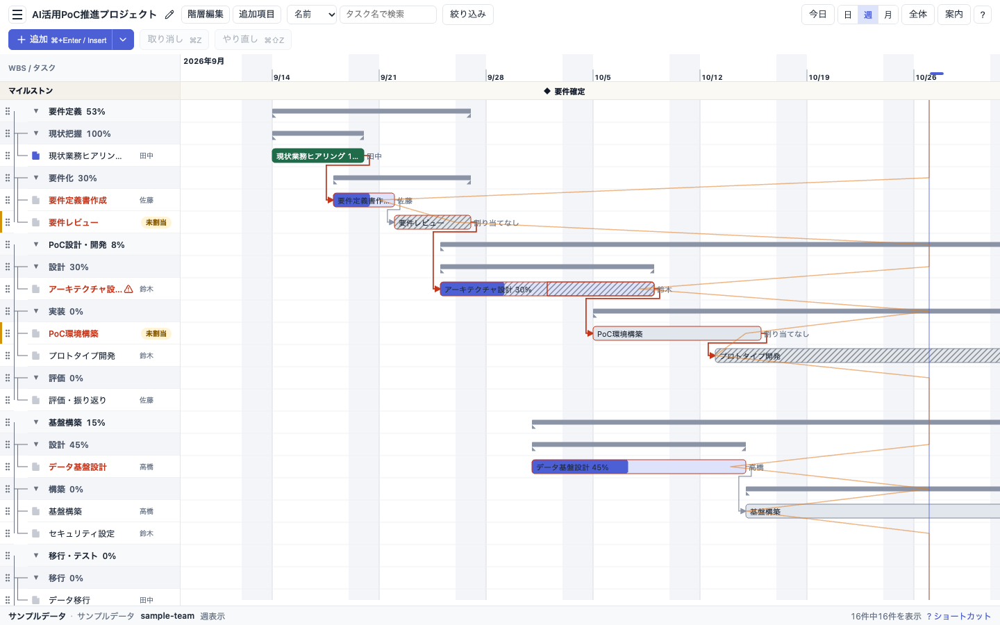

左が名前の一覧で、右が時間軸です。上下のスクロールは左右で揃います。

左上には、スケジュールのタイトル（JSON の title）だけが出ます。タイトルの右の鉛筆、または⌘またはCtrl+Kのコマンドパレットの「タイトルを変更」で、その場の入力から変えられます。鉛筆の右の「階層編集」で、各段の名前・意味・指示を直せます。追加項目の定義は、設定の「拡張項目」から「項目を編集…」で直せます。覆いの中は⌘またはCtrl+Zで取り消せます。「保存」は拡張 JSON だけを上書きし、スケジュールの値はそのままです。必須の項目で値が空のタスクがあるときは、スケジュールの保存ができません。詳細のラベルには「空欄」が出ます。ファイル名は状態バーとウィンドウのタイトルに出し、タイトルを変えてもファイル名は変わりません。ファイル名を変えても、見出しのタイトルは追従しません。保存の状態、メンバーカタログ、表示の粒度、件数も状態バーに出ます。件数は「全件数中、表示件数」の順です。未保存のときは状態バーに「未保存」が出ます。開いているファイルとの差があるあいだは、チャートの右に差分の取っ手が出ます。「未保存」を押すと差分列を開き、結果を出します。別のプログラムが書き換えた内容を画面に反映した直後は、画面の隅に「ファイルを反映しました」と数秒だけ出ます。別のプログラムによる変更をまだ反映していないときは、状態バーに「ファイルに更新あり — 確認する」が出ます。メンバーまたはカレンダーの設定の読み込みに失敗しているときは、状態バーに注意の色で出ます。押すと設定の該当欄が開きます。

上段の「案内」、☰の「操作の案内」、⌘またはCtrl+Kのコマンドパレットの「操作の案内」で、画面の入口と気づきにくい操作とタグの使い方と色の意味をまとめて読めます。この案内は起動時には出ません。?キーとF1でもショートカット一覧を開けます。⌘またはCtrl+Kでコマンドパレットを開き、操作を名前で探して実行できます。macOSのデスクトップ版では、画面上部のメニューバーからも、同じファイル操作と表示の切り替え、ウィンドウの閉じる（⌘W）と最小化（⌘M）が選べます。編集の取り消しは、入力欄にフォーカスがあるときは文字入力の取り消し、それ以外はスケジュールの履歴を戻します。

## ファイルを開く・保存する

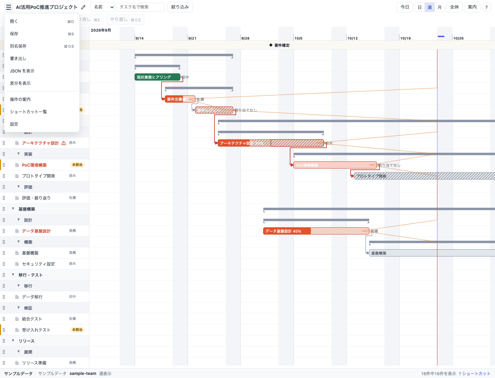

☰を押すと、次の項目が出ます。「開く」・「最近開いたファイル」・「新しいウィンドウで開く」・「保存」・「別名保存」・「書き出し」・「設定ファイルを新しいフォルダへ書き出す」（設定ファイルで開いていないウィンドウだけ）・「JSONを表示」・「差分を表示」・「操作の案内」・「ショートカット一覧」・「設定」です。

☰の「開く」でスケジュールJSONを選びます。中身に問題が無ければ、画面はその内容に替わります。開いた直後は期間がチャートの幅に収まり、一覧は上端から見えます。問題があるときに出るのは理由です。それまでの画面は残ります。

デスクトップ版では、開くことに成功したスケジュールと設定ファイル（`workspace.json` など）を、それぞれ新しい順に最大5件まで覚えます。☰の「開く」の下の「最近開いたファイル」から、スケジュールと設定ファイルの二つの一覧を開きます。件がある側だけ「スケジュール」と「設定ファイル」の見出しが付き、両方あるときは見出しのあいだに区切りがあります。設定ファイルを開くと、書かれた相対パスのスケジュールと、任意のメンバーとステータス一覧とカレンダーと拡張項目を、そのウィンドウだけで使います。設定ファイルで開いたウィンドウでは、メンバーと稼働日は読み取り専用で、ステータスはファイルを読めているときだけ「項目を編集…」で直せます。設定の各欄はそのファイルのパスと読み込んだ状態を示します。アプリの設定で開いているウィンドウ同士では、メンバー、カレンダー、ステータスは同じです。まだ覚えていないときと「履歴を消す」のあとは、同じ行が残りますが押せません。同じファイル名が2件以上あるときだけ、親フォルダ名が付きます。項目にマウスを乗せると、絶対パスが出ます。選ぶと今のウィンドウで「開く」と同じに開きます。一覧の下の「履歴を消す」で、覚えたパスだけを消せます。開いているスケジュールは閉じません。macOSのファイルメニューにも同じサブメニューがあります。⌘またはCtrl+Kのコマンドパレットには、同じ文言で並びます。ブラウザ版では出ません。

デスクトップ版では、検証済みのスケジュールJSONをウィンドウへ落としても開けます。落としたウィンドウの「開く」と同じで、未保存のときは破棄の確認が出ます。JSONが1つでないときや、操作の途中では開けず、理由が出ます。同じJSONをDockやアプリのショートカットへ落とすこともできます。起動していないときは起動と前回の復元のあとに開きます。すでに同じファイルを開いているウィンドウがあるときは、そのウィンドウが前面になり、読み直しはしません。ブラウザ版ではJSONは開かず、ページがファイルへ移らないようにするだけです。

デスクトップ版では、「新しいウィンドウで開く」で今のウィンドウを残したまま、別ウィンドウにスケジュールを開けます。⌘またはCtrl+Shift+Oでも同じです。未保存でも確認は出ません。検証に失敗したときは、今のウィンドウにエラーが出て、ウィンドウは増えません。同じファイルを複数のウィンドウで開けます。別のウィンドウで同じファイルが更新されたときは、今のウィンドウの隅にファイル名と「反映した」か「確認待ち」が出ます。押すと、更新したウィンドウが前面になります。「反映した」は数秒で消えます。「確認待ち」は、その確認が終わると消えます。アプリが他のソフトの後ろにあるときは、同じ内容を OS の通知でも出します。終了は、開いているウィンドウすべての閉じる確認のあとです。キャンセルすると、どのウィンドウも閉じません。

未保存で別のファイルを開くときの確認は、「破棄して開く」か「キャンセル」かです。破棄すると、保存していない変更は失われます。

「保存」は、開いているファイルへの上書きです。まだ保存先が無ければ、保存先を聞きます。「別名保存」が聞くのは、いつも保存先です。

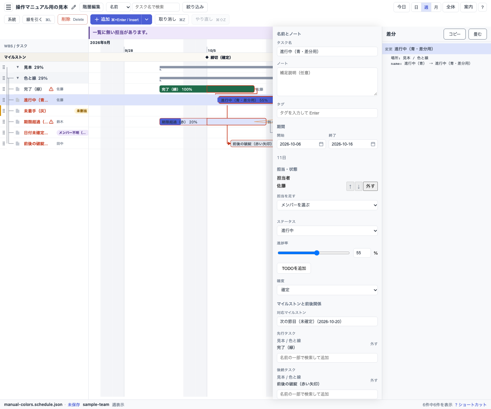

「JSONを表示」は、今の内容を見るだけで、ファイルには書きません。「差分を表示」は、今の画面と開いているファイルとの違いを、チャート右の差分列の一覧に出します。未保存で差があるあいだは、取っ手だけ出し、押すと一覧が見えます。各行は種類と名前の1行です。行を押すか Enter で、その変更の詳細を開き、見えている対象へ寄せます。削除のタスクは、画面に残っている親のグループ行へ寄り、親の行に薄い帯が付きます。見えないときはチャートを動かさず、行に理由が出ます。↑↓ は行を移すだけで、チャートは動きません。一覧にフォーカスがあるあいだは ↑↓ でタスク選択は動きません。一覧、チャート、詳細は操作できます。⌘またはCtrl+Shift+Dで全文をコピーできます。列は開きません。未保存のときは、画面下の状態バーの「未保存」を押しても差分列を開けます。列の「コピー」で、閉じた行の本文も含めた全文を写せます。写したテキストの使い道は、LLMへ渡す変更の指示です。ファイルには書きません。まだファイルを開いていないときとブラウザ版では「比べるファイルがありません」と列に出ます。保存したあとの表示は「差はありません」です。一覧は「畳む」で取っ手に戻せます。空の結果だけ「閉じる」で列をしまえます。開く、保存、別名保存の途中は押せません。

## 表示を動かす

### スクロール

チャートをドラッグすると、縦横にスクロールします。⌘またはCtrlを押しながらの矢印キーも、チャートのスクロールです。上で縦に戻り、下で進みます。左は過去へ、右は未来へです。上下は1行分で、左右も同じ画面上の距離です。押しているあいだは連続して動きます。止まるのは端です。検索欄や選択欄、ボタンにフォーカスがあっても動きます。矢印キーだけでは動きません。ダイアログが開いているあいだも動きません。

ホイールの縦の量は上下、横の量は左右です。左の名前の一覧の上でも、チャートの上でも同じです。タッチパッドでは、二本指を横へ滑らせるだけでも左右に動きます。斜めに滑らせたときは、縦と横が一緒に動きます。Shiftを押しながらのホイールは横です。左の一覧の上でも同じです。日付の行とマイルストンの帯の上では、ホイールの縦の量も横の量も左右に動きます。タッチパッドやドライバが横のイベントを出さないときは、チャートの空白をドラッグするか、Shiftを押しながらホイールを回してください。

縦スクロールで日付の行とマイルストンの下に残るのは、展開しているカテゴリとグループです。`levels` と `outline` があるスケジュールでは、見ている枝の見出しも、浅い方から段の数だけ残ります。残った見出しにも、配下にタスクがあるときは親バーが出ます。次の見出しが来ると入れ替わります。残らないのは、折りたたんだ行です。行が画面に収まるときも残りません。

### 拡大と表示単位

Ctrlまたは⌘を押しながらホイールを回すと、マウスの位置を基準に拡大・縮小します。左の一覧の上では、チャートの左端の日付を保って拡大・縮小します。ツールバーの「日」「週」「月」は、決まった大きさに切り替えます。「今日」は、今日の日付が見える位置へ横だけ動かします。「全体」を押すと、スケジュール全体の期間が画面の幅に収まる大きさになります。

### 折りたたみと一覧の幅

左の三角で、カテゴリやグループを畳めます。畳んでも残るのは、その行のバーです。タスクが無いグループとカテゴリには親バーは出ず、名前だけが見えます。タスクがあるカテゴリ行とグループ行では、配下のタスクを同じ重さで平均した整数の進捗が、名前のうしろに出ます。`status` が `done` のタスクは 100 として数えます。扱いが完了の他の項目は、進捗欄の数字のままです。絞り込みや系統で隠れているタスクも入るので、見えているバーだけを足した数字とずれることがあります。左の名前が途中で切れているときは、その名前にマウスを乗せると全文が出ます。名前をドラッグしても動きません。握り以外をドラッグしても、順番は変わりません。タスク行は、左端の握りをドラッグして順を変えたり、別のグループへ移せます。握りをクリックしてもタスクは選ばれず、詳細パネルも開きません。右クリックでも選択やメニューは出ません。絞り込みや系統で兄弟が隠れているあいだは動かせません。グループ行は、左端の握りをドラッグして順を変えたり、別のカテゴリへ移せます。絞り込みや系統で同じカテゴリのグループが行に出ていないあいだは動かせません。カテゴリ行は、左端の握りをドラッグして順を変えられます。絞り込みや系統でカテゴリが行に出ていないあいだは動かせません。タスクの並べ替えでは、ドラッグ中に半透明のタスク行がポインタに付いて動きます。グループとカテゴリの並べ替えでは、見えている配下の行も含めた半透明の塊が付いて動きます。畳んでいるときは見出しの1行だけです。カテゴリ行とグループ行を右クリックすると、追加と、消せるときだけ削除が選べます。

左の一覧とチャートの境界を横にドラッグすると、一覧の幅を変えられます。ダブルクリックで戻るのは、元の幅です。境界にフォーカスがあるとき、左右キーでも幅が変わります。⌘またはCtrlを押しているときは幅を変えず、チャートが横に動きます。ウィンドウを狭めたときに縮むのは表示だけです。広げると戻ります。

## 絞り込む

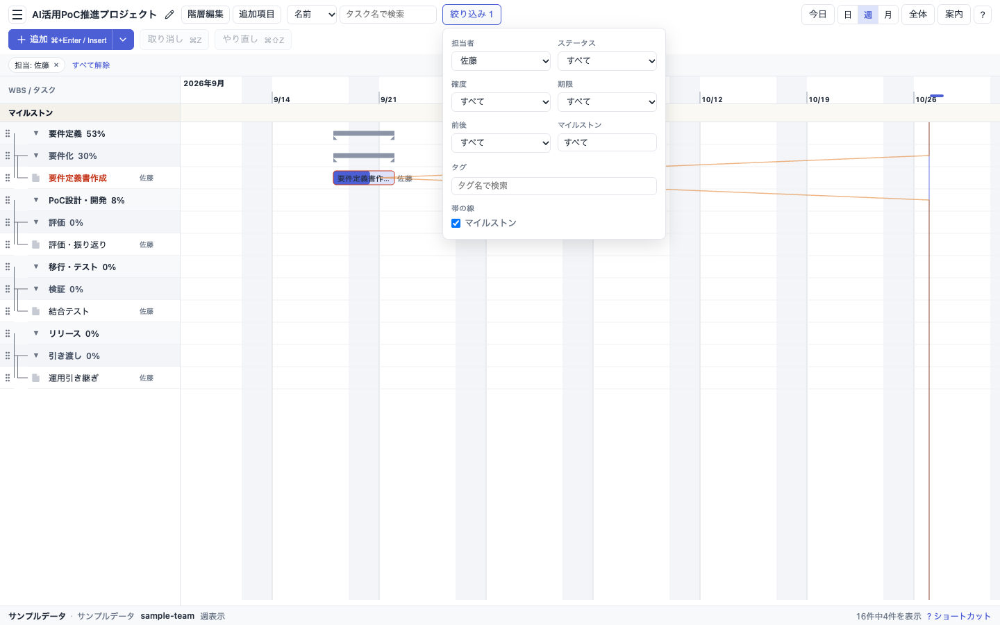

画面上部の検索欄と「絞り込み」パネルの条件は、組み合わせて使えます。欄が窓の下にはみ出すときは、パネルの中を縦にスクロールして届きます。タグ、マイルストン、追加項目の候補は欄の下に重なって出ます。「帯の線」では、マイルストン帯に出すグループごとの線の表示を切り替えます。左のマイルストングループ名の行を右クリックしても切り替えられます。タスク一覧の「マイルストン」絞り込みとは別です。検索欄の左で「名前」か「ノート」を選びます。条件が効いているときは、その下に外せる札が出ます。「すべて解除」は絞り込みだけを戻し、系統は残ります。残るのは、すべての条件を満たすタスクだけです。残ったタスクが無いグループは、行ごと隠れます。

「前後」と「マイルストン」の絞り込みが使うのは、タスクが持つ次の情報です。タスクには、先に済ませておくタスクを登録できます。登録した相手の呼び方は、そのタスクの先行です。逆向きに見た相手を後続と呼びます。設定場所は詳細パネルの「先行タスク」と「後続タスク」です。タスクごとに、関係するマイルストンを1つ結び付けられます。選び方は詳細パネルとタスク複製ダイアログの「対応マイルストン」です。欄に文字を入れて候補を絞り、一覧から選びます。先頭の「なし」で対応を外せます。

| 欄 | 使い方 |
| --- | --- |
| タスク名で検索 | 名前にその文字を含むタスク |
| ノートで検索 | ノートにその文字を含むタスク。ノートが無いタスクは残らない |
| 担当者 | 「割り当てなし」は、担当者のいないタスクと、担当者のIDがメンバーに見つからないタスクの両方 |
| ステータス | 使用中のステータス一覧の項目。「完了以外」は、扱いが完了の項目を除いたタスク |
| 確度 | 「未確定」は日付が未合意のタスク。「確定」は合意済みのタスク。着手や進捗とは別 |
| 期限 | 「期限超過」は、今日より前に終わる未着手と着手済みのタスク。完了と管理外と一覧に無いステータス ID は、終了が過去でも残らない |
| 前後 | 「前後: 破綻のみ」は、後続が先行の終了より前に始まっている組 |
| マイルストン | 欄に文字を入れて候補を絞り、一覧から選ぶ。検索語が空のときは先頭に「すべて」と「なし」が出る。「なし」は対応が無いタスク。マイルストンを選ぶと、そのマイルストンに結び付いたタスクだけ |
| タグ | 欄に文字を入れて候補を絞り、チェックで選ぶ。空のときはファイル内のタグをすべて候補に出す。一つもオンにしていないときはタグでは絞らない。一つ以上オンのときは、そのどれかを付けたタスクだけ。見出しの横の「選択を外す」で、選んでいるタグをまとめて外せる。選んだタグは札に出し、札を押すとそのタグだけ外れる |

タスクを選んで「系統」を押すと、そのタスクの前と後につながるタスクだけが残ります。ボタンに出るのは、起点にしたタスクの名前です。もう一度押すと解除します。絞り込みを変えると外れるのは、選んでいたタスクの選択です。

## 色と線の見かた

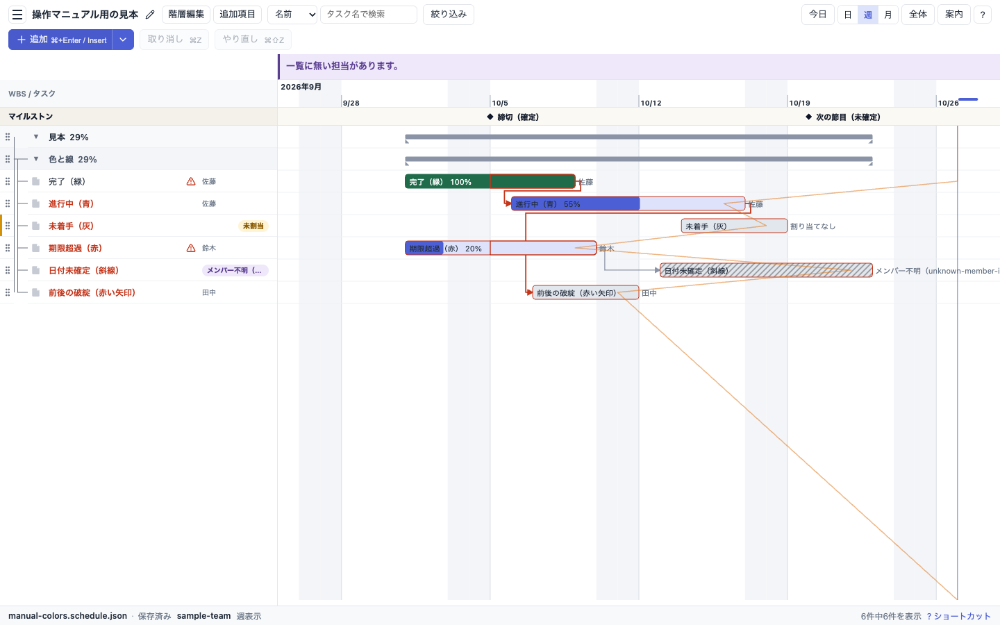

| 見た目 | 意味 |
| --- | --- |
| 灰色のバー | 既定の一覧では未着手 |
| 薄い青のバー | 既定の一覧では進行中 |
| 緑のバー | 既定の一覧では完了 |
| バーの中の濃い部分 | 進捗率。進捗が1以上なら、どのステータスにも出る |
| 赤い枠のバー | 期限超過。未着手と着手済みだけが対象。完了と管理外と一覧に無いステータス ID は超過にしない。終了日が今日なら超過にしない |
| 斜線のバー | 日付が未確定。色はステータスや期限超過のまま。確定はベタ塗り |
| 斜線のひし形 | 未確定のマイルストン。確定は塗りつぶしたひし形 |
| 一覧の「未割当」 | 担当者がいないタスク。琥珀色の札で示す |
| 一覧の「メンバー不明」 | 担当者IDがカタログに無いタスク。IDも出る |
| マイルストンより右の赤い枠と、行の「超過」 | 対応マイルストンの日を過ぎている。当日は超過にしない |
| 細い帯と両端の角 | カテゴリやグループの範囲。途切れた期間は点線、つながる期間は塗り |
| オレンジ色の折れ線 | 今日の位置を示すイナズマ線。扱いと期間で折れ先が変わる。未着手は開始前が今日・期間中が開始日・終了後が終了日、着手済みは開始前が開始日・期間中が今日・終了後が終了日、完了は開始前と期間中が終了日・終了後が今日、管理外と一覧に無いステータス ID はどの期間も今日。終了日が今日の行は終了より先へ折れない |
| 矢印 | 先行から後続へ引く線。終了と開始が近いときは、後続の左の外から入る。後続が先行の終了より前に始まるときは赤い |
| 薄い灰色の背景 | 非稼働日。カレンダーを入れるまでは土日。月表示では塗らない |

## 編集する

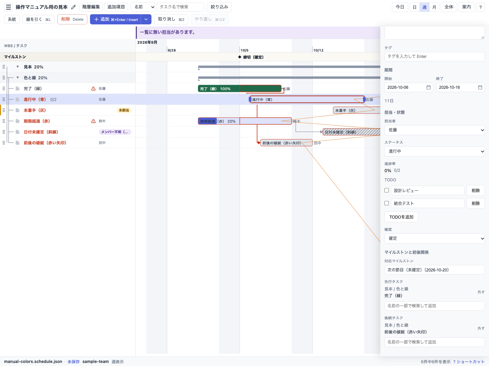

### 選択と移動

タスクを選ぶのは、右のバーまたは左の名前をクリックしたときです。右クリックでも選べます。⌘ または Ctrl+クリックで足したり外したり、Shift+クリックで見えている範囲を選べます。Shift+↑↓ で選択を伸ばしたり縮められます。↑↓で見えているタスクの前後へ移せます。移したあと、行が画面外なら一覧を動かして入ります。

移動するには、バーの本体を横にドラッグします。2件以上選んでいるときは、選んだバーをドラッグすると、選択中のタスクが同じ日数だけ動きます。⌘またはCtrlを押したドラッグでも同じです。少し動かすまでは選択だけが変わり、8pxを超えてから移動が始まります。ドラッグ中は開始日と終了日が`4/3`の形で出て、離すと消えます。日付が重ならない相手は、棒と、もう一方の日付です。確定するのは、離したときです。Escapeを押すと、離す前の日付に戻ります。空いた所、スペースキー、中ボタンのドラッグはスクロールのままで、日付は出ません。

期間を変えるには、バーの左右の端をドラッグします。2件以上選んでいるときは端のハンドルは出ず、端の操作も期間変更にはなりません。1件のときは、選んでいなくても変えられます。端とその周りをクリックしても、タスクは選ばれず、詳細パネルは開きません。右クリックのメニューも出ません。1日より短くはできません。ドラッグ中に出る日付は、移動のときと同じく開始日と終了日です。確定するのは離したときです。Escapeを押すと、離す前の形に戻り、履歴には積まれません。

そのタスクが端になっている前後の線は、離す前の日付で色が変わります。後続の開始が先行の終了より前になると、赤く太くなります。同じ日なら赤くなりません。離すまで変わらないのは、他の線と、見えている行です。終了日を非稼働日にしても「休」は出ず、バーの長さは暦日のままです。

### 詳細パネルと線

タスクを選ぶと、チャートの右に詳細パネルが出ます。2件以上選ぶと、同じ位置に一括用のパネルに切り替わります。空欄と「変更しない」の項目は変わりません。「件数に適用」で、書いた項目だけをまとめて反映します。担当の「割り当てなし」と「変更しない」は別の選び方です。値が揃っていない項目は空欄か「変更しない」で、「複数の値」と出る欄もあります。共通の値に戻した欄は下書きから外れます。名前、ノート、進捗率、TODOは1件のときだけ編集できます。「TODOを追加」で足し、チェックと文を直せます。TODOがあるときは進捗率を手で直せず、済んだ件数と全体の件数が進捗率の横に出ます。左のタスク行でも、TODOがあるときだけ名前の直後に `3/6` のように出ます。1件のときは、TODOを変えるとその都度スケジュールに反映されます。1件のときだけ、バーの本体をダブルクリックするか、選択中に Enter を押すと、パネルの名前欄にフォーカスが移ります。2件以上のときは、ダブルクリックも Enter も名前欄へは移りません。端の当たりでは移りません。変えられる項目は、名前・ノート・タグ・日付・担当・ステータス・進捗・確度・対応マイルストン・先行・後続です。タグは札で外し、入力して Enter で足します。対応マイルストンは文字で候補を絞り、選んだときに反映されます。Alt+←→で開始日と終了日を、選択中のタスクすべてを1日ずつ動かします。Shift+Alt+←→で終了日だけを1日ずらせるのは、1件のときだけです。

チャート上で線を足すには、タスクを選んで「線を引く」を押すか、⌘またはCtrl+Lを押します。Lだけでは始まりません。ボタンに出るのは起点の名前です。次にクリックしたタスクが後続になります。モードは残るので、続けて足せます。終わらせ方は、起点の再クリック・Esc・「線を引く」・⌘またはCtrl+Lです。すでに結ばれているときと、循環するときは足しません。失敗の理由は、チャート上端の帯に出ます。見えていないタスクへは、チャートをドラッグしてスクロールしてからクリックします。画面の外を指して結ぶ操作はありません。空きや親バー、背景を少し動かすとスクロールします。タスクバーでは、8px 以上動かすとスクロールになり、線は足しません。8px 未満で同じバーの上で離したときだけ、クリックと同じで後続になります。スペースキーを押したまま同じバーを少し動かして離したときも、クリックと同じで後続になります。スペースキーを押したドラッグと中ボタンのドラッグも、モード中はスクロールします。中ボタンでは線は足しません。詳細パネルの先行と後続も、今までどおり使えます。

線を外すには、線にカーソルを合わせてDeleteまたはBackspaceを押すか、右クリックの「線を外す」を選びます。確認は出ません。消えるのはその1本だけで、タスクは残ります。バーや、ひし形と名前の上では、今までどおりタスクの削除確認です。

### 右クリックと複製

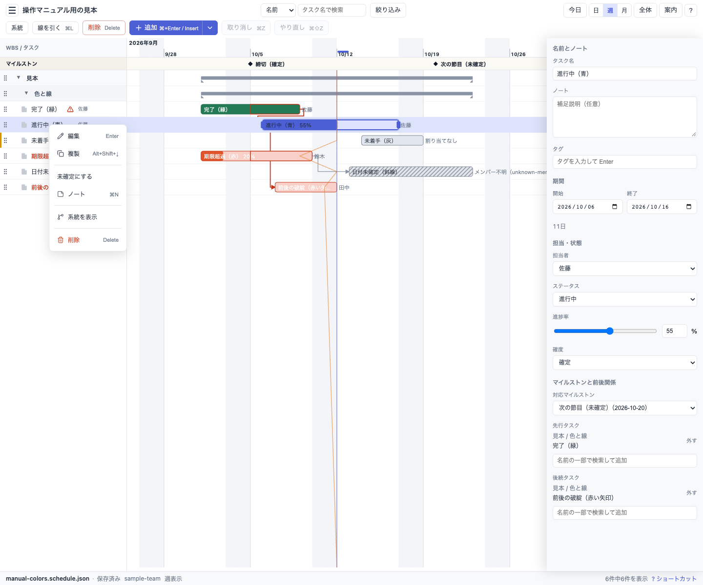

タスクのバー、または左のタスク行を右クリックすると、メニューが出ます。2件以上選んでいるときは「削除」だけです。1件のときは「編集」・「複製」、確度、ノート、系統、削除のあいだに区切りがあります。削除は赤い文字です。Enter、複製のAlt+Shift+↓、ノートの⌘NまたはCtrl+N、Deleteは項目の右に出ます。確度を切り替えても日付は動きません。線を引いているあいだは、このメニューは出ません。

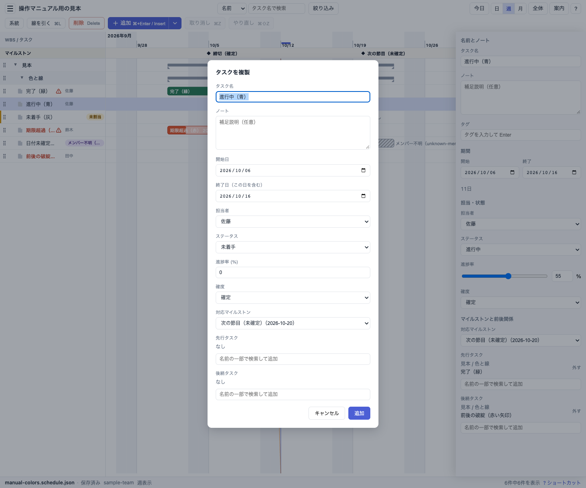

「複製」、または選択中にAlt+Shift+↓では、元の内容を写したダイアログが開きます。写す項目はタスク名・ノート・日付・担当・確度・対応マイルストンです。タグも元から写します。ダイアログには出ません。ステータスは一覧の未着手、進捗は0、先行と後続は空です。追加前に、これらは変えられます。対応マイルストンも詳細パネルと同じ欄で文字から選べます。ダイアログで変えた内容は、「追加」するまでスケジュールには反映されません。名前を直して「追加」すると、同じグループの直後に足されます。同じ名前のままでも足せます。キャンセルとEscapeでは増えません。

マイルストンのひし形、またはその右の名前を右クリックすると、メニューが出ます。項目は「編集」と、今の確度と逆の「確定にする」または「未確定にする」と、「削除」です。確度を切り替えても日付は動きません。右クリックしても、タスクの選択は変わりません。

左のマイルストングループ名の行を右クリックすると、「非表示」と、帯に出ている別のグループ行があるときだけ「この行だけ表示」が出ます。どちらも「帯の線」のオンオフと同じです。右クリックしても、タスクの選択は変わりません。線を引いているあいだは、このメニューは出ません。

先行と後続の候補は、一度に50件まで出ます。多いときは、名前で検索して絞ります。対応マイルストンと絞り込みパネルの「マイルストン」も同じく50件までで、名前か日付の一部で絞れます。絞り込みでは、文字を入れただけでは条件は変わりません。一覧から選んだときだけ絞り込みが変わります。

### ノートと名前

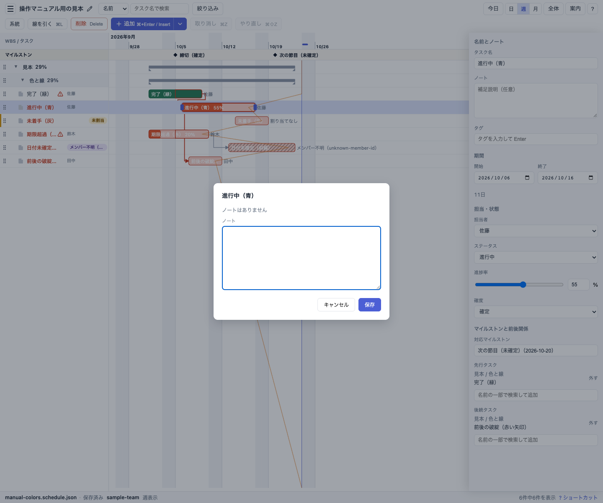

ノートを開く入口は、左のノートアイコン・右クリックの「ノート」・選択中の⌘またはCtrl+Nです。Nだけでは開きません。アイコンの色で、ノートの有無が分かります。空白だけにして保存したときに消えるのは、ノートです。

マイルストンの日付は、ひし形、またはその右の名前を横にドラッグして変えます。確度もグループも変わりません。名前・日付・確度を変える操作は、ひし形か名前のダブルクリックか、右クリックの「編集」です。マイルストングループが2件以上あるときは、編集でグループも選べます。帯の線がオフのグループや、中身が空のグループも候補に出ます。別のグループへ移したあと、移した先の帯の線がオフだったときは、そのグループだけオンに戻ります。取り消しでは線の表示は戻りません。名前が空白だけなら、元の名前のまま残ります。

カテゴリとグループの名前は、左の行をダブルクリックするか、右クリックの「名前を変更」で変えます。空白だけのときの結果は、元の名前のままです。すでに使っている名前には変えられません。折りたたんだままの行は、名前を変えても折りたたんだままです。

### 追加と削除

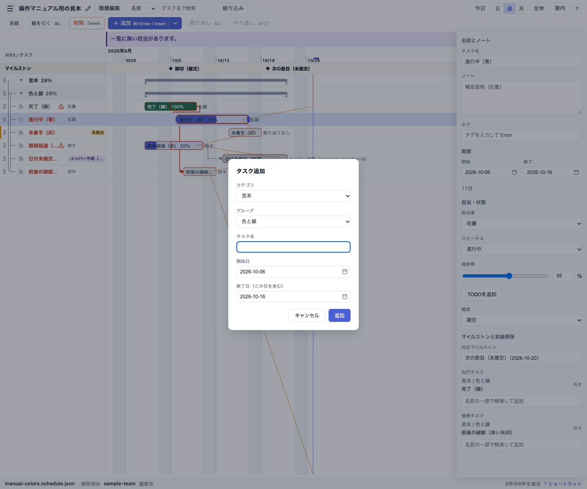

「追加」、または⌘またはCtrl+Enter、Insertでは、既存のカテゴリとグループを選び、そのグループの末尾にタスクを足します。ダイアログを開くと、タスク名の欄にフォーカスがあります。タスク名を入れてEnterで追加できます。終了日に指定した日も期間に含まれます。足したタスクの確度は未確定です。確度を「確定」で絞っているときだけ、その絞り込みは「すべて」に戻ります。

「マイルストン追加」、または⌘またはCtrl+Shift+Enterで指定するのは、名前・日付・確度です。マイルストングループが2件以上あるときは、グループも選べます。マイルストンが無くても押せます。ツールバーから開いたときの名前は空です。日付は今日で、確度は未確定です。グループの初期値は、並びの先頭のグループです。先頭のグループに帯の行が無いときは、見えている帯の最上段とは別になります。日付ヘッダー・帯の空き・チャートの空きを右クリックして「マイルストンを追加」を選ぶと、同じダイアログが開きます。そのときの日付の初期値は、指した位置の日です。帯の空きから開いたときのグループの初期値は、指した縦位置のグループです。どのグループの帯にも入らない位置なら、並びの先頭のグループです。日付ヘッダーとチャートの空きから開いたときのグループの初期値も、並びの先頭のグループです。名前と確度の初期値は、ツールバーから開いたときと同じです。帯の線がオフのグループを選んで足しても、帯の線は変わりません。ひし形は、線をオンにするまで帯には出ません。右クリックでは、タスクの選択は変わりません。線を引いているあいだは、この項目は出ません。ひし形が出る位置は、指定した日付です。マイルストングループが1件のときは、先頭のグループに入ります。グループが無いときは、「マイルストン」というグループができます。未確定は斜線で、確定は塗りつぶしです。名前が空白だけ、または日付が空のときは足しません。ダイアログは開いたままです。同じ名前と日付でも足せます。キャンセルとEscapeでも足しません。

「削除」は、タスクを選んでから押します。DeleteまたはBackspaceでも同じ確認が開きます。消えるのは、確認のあとです。消したタスクとの前後関係は外れます。その前後にあったタスク同士を自動でつなぎ直すことはしません。ツールバーの「削除」とDeleteでは、マイルストンは消えません。

ひし形、またはその右の名前の右クリックの「削除」では、確認のあとにマイルストンが消えます。外れるのは、そのマイルストンを指していたタスクの対応だけです。日付は変わりません。絞り込んでいたマイルストンを消すと、マイルストンの絞り込みは「すべて」に戻ります。残るのは選択と系統です。取り消しても、絞り込みは「すべて」のままになります。

### 取り消しと、入力中のキー

取り消しのキーは⌘またはCtrl+Zです。やり直しは⌘またはCtrl+Shift+Zか、Ctrl+Yで行います。戻せるのは確定した編集だけで、最大100件です。絞り込みやスクロールは戻りません。

検索欄やダイアログへ文字を入力しているあいだ、取り消し・やり直し・Enterでの名前欄への移動・Deleteでの削除・線を引く・ノートを開く・タスクの追加・マイルストンの追加・複製・同じグループでの並べ替えには使われません。詳細パネルの欄にフォーカスがあるときも、↑↓での選択移動とAlt+←→とShift+Alt+←→での日付変更はその欄の操作のままです。⌘またはCtrl+S・⌘またはCtrl+Shift+S・⌘またはCtrl+O・⌘またはCtrl+Fは、検索欄にフォーカスがあっても効きます。⌘またはCtrlと矢印も、検索欄・選択欄・ボタンにフォーカスがあってもチャートをスクロールします。矢印キーだけのときの動作は、その欄の操作のままです。ダイアログが開いているあいだは、これらも効きません。⌘またはCtrl+Nは、ノートを開くときも開かないときも、ブラウザの新しいウィンドウにはなりません。開かない条件は、ダイアログ・選択が無いとき・線を引くモード・検索欄・選択欄です。タスクを選んでいるときは、ボタンにフォーカスがあっても開きます。

## 書き出す

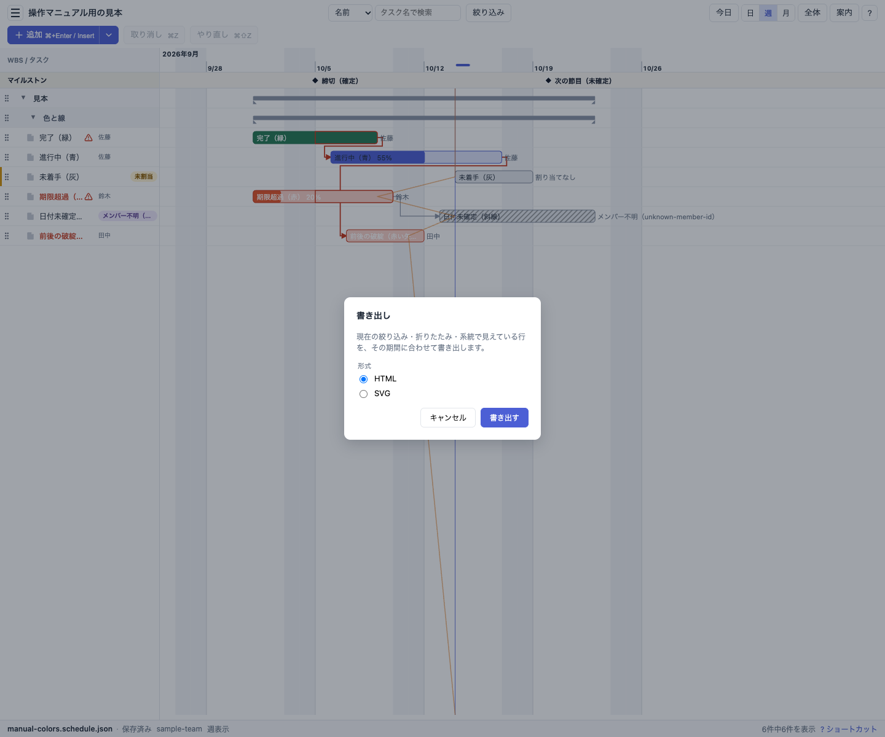

残したい行だけになるように、絞り込み・折りたたみ・系統を使います。☰の「書き出し」で選ぶ形式はHTML、SVG、またはデスクトップ版だけのExcelです。「書き出す」を押して保存します。Excelでは、名前のほかに出す左の列を選べます。初期は開始、終了、ノートだけがオンです。TODO 列は初期はオフで、オンにするとタスクごとに `[x]` と `[ ]` の印付き平文が1セルに入ります。ノートのセルには混ぜません。選んだ列は次の書き出しでも使われます。ノートは1セルに入り、改行はそのまま残ります。

書き出しに入るのは、絞り込みや折りたたみで隠していない行と、その期間に関係するマイルストンです。画面の外にスクロールしている行も入ります。絞り込みで隠したタスクは入りません。日・週・月の表示単位は、画面と同じです。HTMLとSVGは、左の縦線と行の地、チャートの親バーを画面と同じにします。Excelでは、名前の字下げと行の塗りも画面に合わせます。一番上の見出しだけ左の列を塗り、タスクは直上の見出しより1段深く字下げします。定義の無い3段は、これまでどおりカテゴリ・グループ・タスクの字下げです。Excelでは、先行バーの右辺の中央から後続バーの左辺の中央へ付いたカギ線矢印で前後をつなぎ、設定でオンにしているときは今日の位置に縦線が1本入ります。

行が10,000を超えるとき、または図が横200,000pxか縦50,000pxを超えるときは、保存せずに理由を表示します。絞り込みや折りたたみで範囲を減らしてください。

## 設定

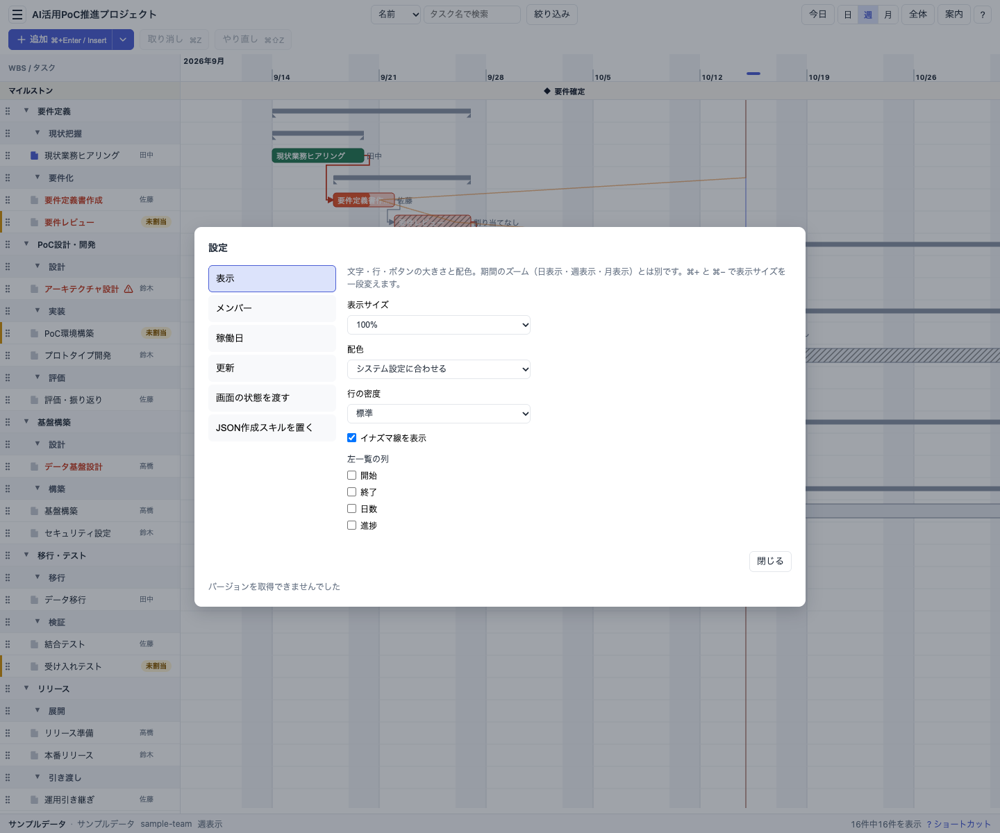

設定を開くと、どの欄を見ていてもダイアログの下に今の版が1行出ます。デスクトップ版の☰の「設定」には、表示、メンバー、ステータス、稼働日、更新、画面の状態を渡す、JSON作成スキルを置くの7つがあります。ブラウザ版には「更新」と「画面の状態を渡す」はありません。

「表示」では、文字と行とボタンの大きさと配色を変えます。開いているウィンドウでは、メンバー、カレンダー、文字の大きさ、配色、一覧の幅、行の密度、イナズマ線、一覧の列は同じです。配色はライトとダークと、システムに合わせる設定です。「自動」か、50%から200%を選びます。一段変えるキーは、Macでは⌘+と⌘−、それ以外ではCtrl++とCtrl+-です。検索欄やダイアログが開いていても変わります。チャートのズームはCtrlまたは⌘とホイールで、表示サイズとは別の設定です。同じ欄で、左一覧に開始・終了・日数・進捗・ステータスを出せます。開始と終了は「09/19」のような月と日、日数は「12日」、進捗は「30%」、ステータスは一覧の表示名です。一覧に無いステータスは、メンバー不明と同じ色の札でIDだけが出ます。ステータスが長いときも省略され、マウスを乗せると全文が出ます。開始、終了、日数、進捗、ステータス、超過、担当は、行をまたいで同じ位置に揃います。超過が無い行も、その幅は空きます。担当が長いときは省略され、マウスを乗せると全文が出ます。初期はどれも出しません。

スケジュールのどこかに、設定で選んでいるステータス一覧やメンバー一覧に無いIDがあるとき、または追加項目の定義に無い `fieldValues` のキーがあるとき、チャートの上端に短い帯が出ます。帯の地と文字は、一覧に無いステータスの札と同じ色です。「一覧に無いステータス」「一覧に無い担当」「一覧に無い追加項目」を、あるものだけ「と」でつないで「があります。」と出します。絞り込みで行が隠れていても帯は出ます。定義に無い追加項目は詳細で文字列と値だけ見え、編集できません。直すときは、詳細パネルや設定の一覧をLLMに渡して直し、ファイルを開き直してください。

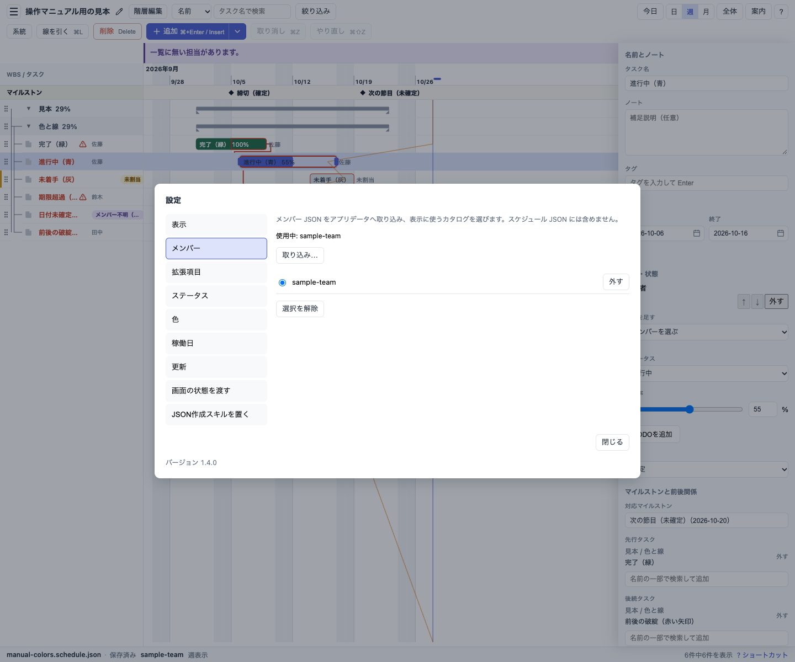

「メンバー」では、メンバーJSONを取り込みます。取り込んだ1件の呼び方は「カタログ」です。使うカタログを1つ選ぶと、タスクの担当者IDが名前で表示されます。メンバーを書く先は、スケジュールのファイルではありません。

「拡張項目」では、複数スケジュールで共有する追加項目の定義JSONを取り込み、チェックで複数選べます。一覧と覆いの選択肢には、拡張の名前のうしろにプラグイン ID を括弧で添えます。値のキーは `プラグインID_項目ID` です。選んでいる拡張どうしで合成キーが重なるものは同時に選べません。「項目を編集…」で定義を直せます。覆いでは拡張の名前とプラグイン ID を変えられ、今回足した項目の ID も変えられます。覆いを閉じると設定の「拡張項目」に戻ります。設定ファイルで開いたウィンドウでは、`fieldExtensions` に書いた拡張はピン留めとして読み取り専用で表示します。編集用の拡張は「編集用の拡張を作る」で一つだけ足し、「項目を編集…」で直せます。「消す」で設定ファイルから外し、ファイルを消せます。取り込みと選択の変更は出ません。

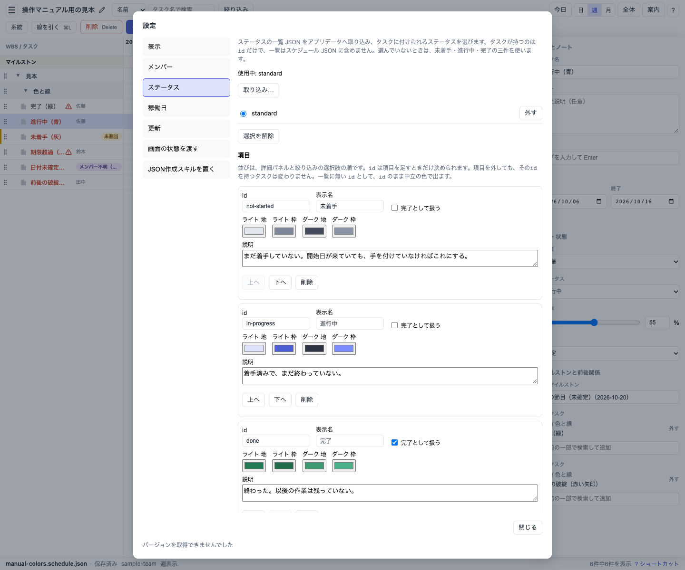

「ステータス」では、ステータス一覧JSONを取り込みます。使う一覧を1つ選ぶと、バーの色、詳細パネルの選択肢、絞り込みがその一覧の項目になります。一覧を選ばないときは、未着手・進行中・完了の3つです。各項目は、表示名、ライトとダークの色、扱い（未着手・着手済み・完了・管理外）、説明、任意の指示を持ちます。説明はLLMがそのidを選ぶ状態、指示は選んだあとにLLMが守ることです。扱いは、イナズマ線の折れ位置と期限超過と「完了以外」に使います。「項目を編集…」で設定を閉じ、主画面の覆いを開きます。覆いのあいだは、絞り込みや追加など、下の操作はできません。

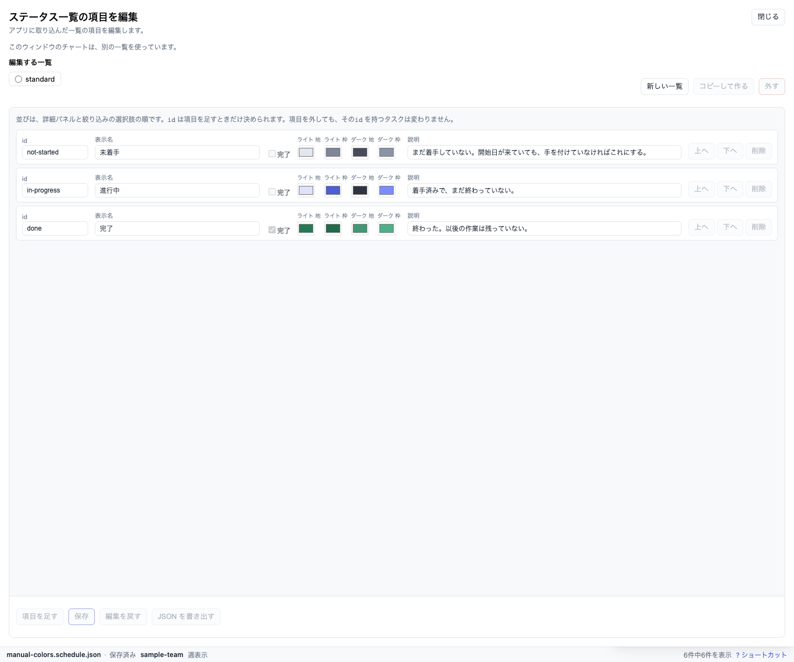

覆いでは、見出しの右の「閉じる」で戻ります。下書きがあるときは、閉じる前に捨てるかを聞きます。項目の一覧だけがスクロールし、保存などの操作は足元に残ります。

取り込み済みの一覧を「編集する一覧」で選び、項目を直します。横の「新しい一覧」は、組み込みの未着手・進行中・完了から、アプリに一覧を足します。「コピーして作る」は、選んでいる一覧の内容（下書きを含む）を写して同じ手順で足します。一覧を選んでいないときはコピーは押せません。

「外す」は、選んでいる一覧を設定と同じ手順でアプリから消します。確認のあと進めたときも覆いは開いたままです。残っている一覧があれば、その先頭を開きます。使用中の一覧を外すと、チャートは組み込みの三件に戻ります。

表示名と色を直し、行のどこを押してもその行を選べます。選んでいる行は左の帯で分かります。各行には、その項目の説明が1行出ます。右で説明と指示を書き、行の中で扱いを選び、「上へ」「下へ」で並べ、「削除」で外し、「項目を足す」で足します。選んでいる扱いの説明は、扱いの直下に2行で出ます。幅を変えても行数と色・操作の位置は変わりません。極端に狭いときだけ末尾が省略されます。別の扱いに乗せると、選ぶ前に説明だけ差し替わります。覆いを開いてから閉じるまで、⌘またはCtrl+Zで下書きを取り消し、やり直しもできます。スケジュールの取り消しは動きません。足すときだけ`id`も決められ、説明は空で、保存したあとは`id`を変えられません。「保存」は選んだ一覧を上書きします。使用中の一覧を保存したときだけ、バーの色などが変わります。「JSONを書き出す」で、チームに配れるファイルにできます。書き出しだけでは使用中は変わりません。作っただけでは使用中にはしません。項目を外しても、その`id`のタスクは変わらず、`id`のまま灰色で出ます。

設定ファイルで開いたウィンドウでは、ステータスファイルを読めているときだけ「項目を編集…」が出ます。覆いではそのファイルだけを直し、保存するとこのウィンドウのチャートが変わります。取り込みや一覧の切り替えはできません。

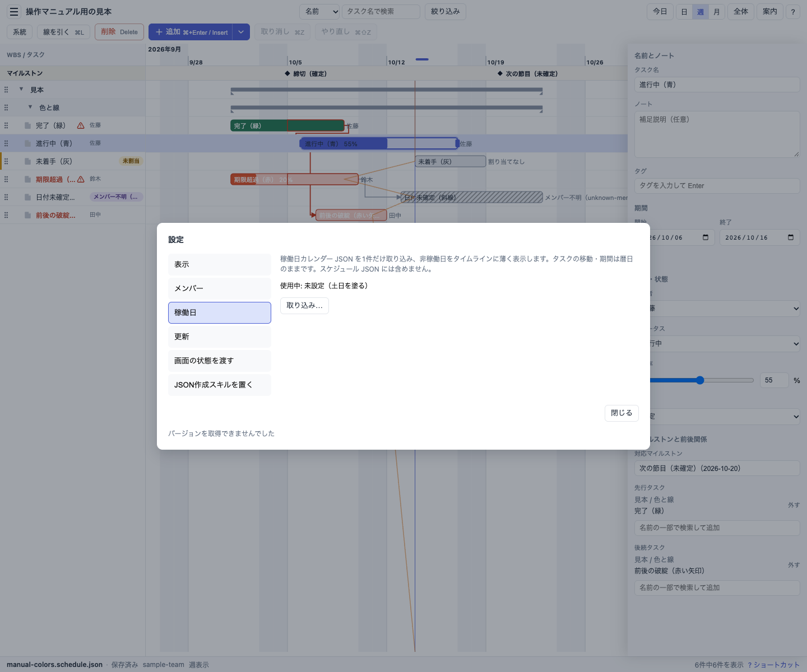

「稼働日」では、休日と振替出勤を書いたJSONを1件取り込みます。未設定のときは土日を塗ります。変わらないのは、タスクの日付の計算です。

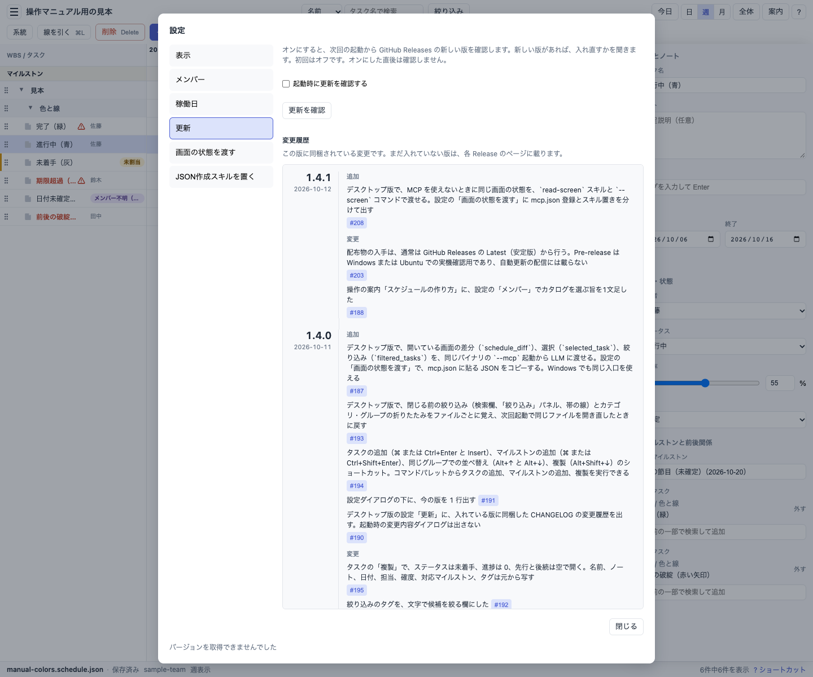

Microsoft Store から入れた Windows 版は、Windows が更新します。設定の「更新」にはその旨と変更履歴だけが出ます。アプリ内の「更新を確認」や入れ直しはありません。

GitHub Releases から入れた Ubuntu 版と Apple Silicon の Mac 版には「更新」があります。ベータ用の Windows インストーラにも、同じメジャーのベータを「インストーラを保存」で取る欄があります。Mac にはこの保存欄はありません。既定はオフです。「起動時に更新を確認する」をオンにすると、次回の起動から、入っている版と同じメジャーの、より新しい安定版を確認します。Ubuntu と Mac では見つかったとき、すぐ入れ直さず、「あとで」か「入れ直す」かを聞きます。Mac の入れ直しに管理者の確認は出ません。入れ直し後の起動では Gatekeeper の警告は出ません。初回の警告は、dmg から入れたときだけです。次のメジャーへは自動では進みません。手で入れた版は、そのメジャーの確認先を見ます。オンにした直後は確認しません。同じ欄の「更新を確認」は、自動更新のオンオフに関係なく、その場で確認できます。☰ の「更新を確認」、コマンドパレット、macOS のアプリメニューからも始められます。GitHub Releases から入れた古い Windows 版で「更新を確認」したときは、安定版は Microsoft Store で入手・更新する旨が出ます。同じ欄の「変更履歴」では、入れている版に同梱された CHANGELOG をいつでも読めます。起動時には出ません。まだ入れていない版は、各 Release のページに載ります。Ubuntu と、ベータ用の Windows では、公開中のベータの、この OS 用インストーラを「インストーラを保存」で別名保存できます。保存したファイルの実行と入れ替えは、利用者が行います。Ubuntu では安定版の入れ直しに管理者の確認が出ます。ベータの Windows では、更新の途中で SmartScreen の確認が出ることがあります。自動更新を含む版を一度手で入れたあとから、この機能の対象になります。

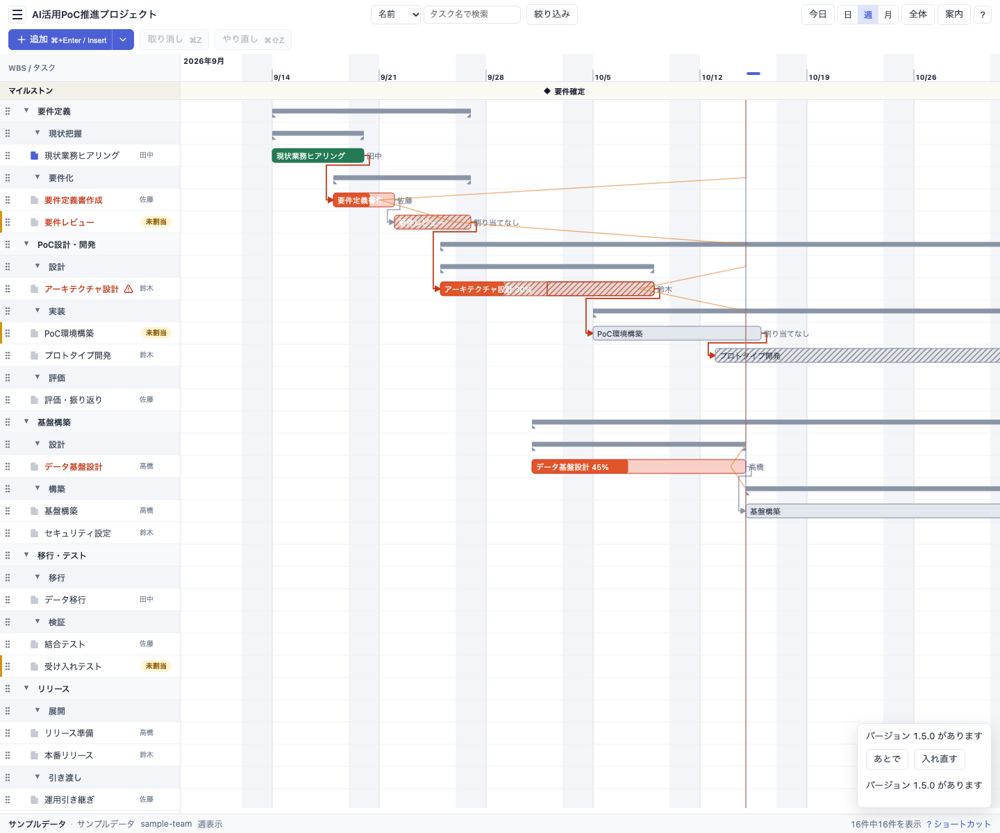

知らせは状態バーの直上に出ます。設定を開いているあいだは、同じ内容を「更新」欄だけに出し、隅には出しません。

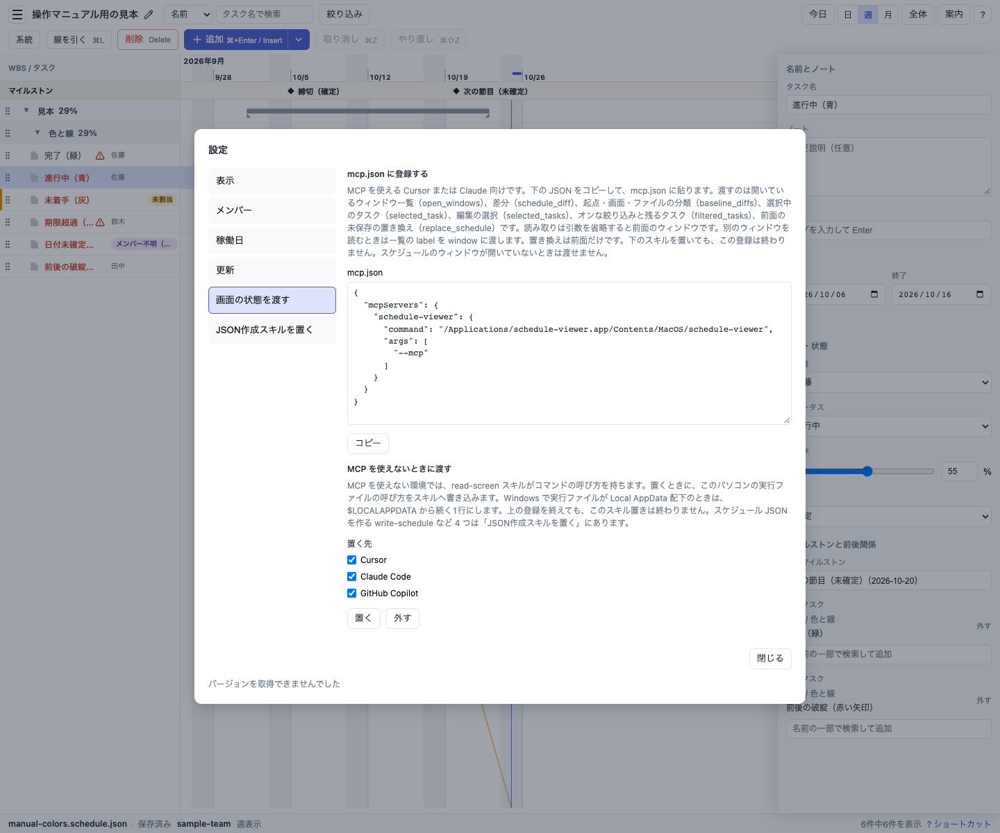

「画面の状態を渡す」は、mcp.json への登録と、MCP を使えないときのスキル置きの 2 つに分かれています。どちらか一方を終えても、もう一方は終わりません。スケジュール JSON を作る「JSON作成スキルを置く」とも別です。

「mcp.json に登録する」では、JSON をコピーして Cursor または Claude の mcp.json へ貼ります。MCP を使えるクライアント向けです。スケジュールのウィンドウが開いているときだけ連携できます。読み取りは `open_windows`（開いているウィンドウ一覧。ファイル名と親フォルダ名だけ。絶対パスは含みません）、`schedule_diff`（差分テキスト）、`baseline_diffs`（起点・画面・ファイルの差分と分類）、`selected_task`（選択が1件のときのタスク。選択数が不明なときは使わない）、`selected_tasks`（編集の選択。1件でも配列。選択数が不明なときはこちら）、`filtered_tasks`（オンな絞り込みと残るタスク）、`current_schedule`（画面のスケジュール JSON 全体。未保存の画面）です。読み取りは引数を省略すると前面のウィンドウです。別のウィンドウを読むときは、一覧の `label` を `window` に渡します。`replace_schedule` で、起動中に開いているスケジュールを変える依頼を、スケジュール JSON 全体の未保存として前面だけ置き換えられます。新しいスケジュールファイルの作成や、アプリが起動していないときのファイル書きには使いません。ファイルには書きません。必要なツールだけ呼べます。設定からプロセスは起動しません。

「MCP を使えないときに渡す」では、`read-screen` スキルを Cursor、Claude Code、GitHub Copilot のユーザー用フォルダへ置きます。GitHub Copilot は `~/.copilot/skills/read-screen/` だけです。置くときに、このパソコンの実行ファイルの呼び方をスキルへ書き込みます。Windows で実行ファイルが Local AppData 配下のときは、`$LOCALAPPDATA` から続く1行にします。スキルは、読み取り 7 つをコマンド（`--screen` とツール名。背面は `--window` と label）で渡す手順と、画面の更新手順（`replace_schedule` 相当）を持ちます。上の mcp.json 登録を終えても、このスキル置きは終わりません。

同じファイル名のカタログや、すでにあるカレンダーを取り込むときは、上書きしてよいかを聞きます。

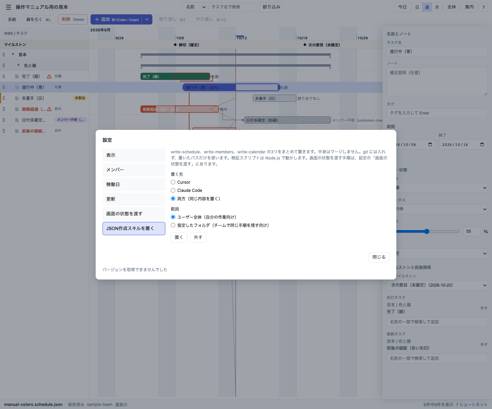

「JSON作成スキルを置く」では、write-schedule、write-members、write-calendar、write-workspace、write-fields の5つをまとめて置けます。Cursor、Claude Code、GitHub Copilot のうち置く先を1つ以上選び、ユーザー全体か指定したフォルダかを選びます。自分の作業ならユーザー全体、チームで同じ手順をリポジトリに残すなら指定したフォルダを使います。GitHub Copilot はユーザー全体なら `~/.copilot/skills/`、指定したフォルダなら `.github/skills/` です。置いたパスだけを示し、git には入れません。同名フォルダがあるときは上書きを確認します。「外す」で、同じ選び方の場所から5つだけ削除できます。デスクトップ版だけ使えます。ブラウザ版では同じ欄に、デスクトップ版で置く旨だけ出ます。`.cursor` と `.claude` と `.copilot` と `.github` と、それぞれの `skills` がシンボリックリンクのときは置けません。外すときも、リンクの先は消しません。

## ほかのプログラムがファイルを書き換えたとき

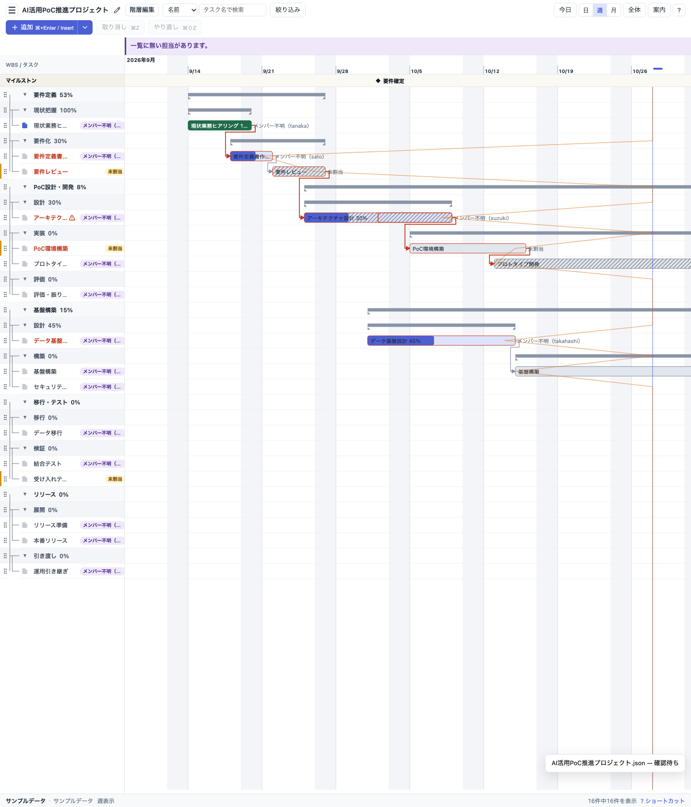

デスクトップ版が定期的に確かめるのは、開いているファイルが書き換えられていないかです。

未保存の編集がなく、詳細パネルにも入力の途中が無いとき、内容に問題が無ければ画面へ反映します。反映した直後は、画面の隅に「ファイルを反映しました」と数秒出ます。

未保存の編集があるときは、ファイルが変わったタイミングで「ファイルが更新されています」が開きます。確認では、画面の変更とファイルの変更が節に分かれ、変わった項目を読んでから選べます。「画面の編集を残す」を選んだあとは、状態バーの「ファイルに更新あり — 確認する」が同じ確認へ戻る入口になります。

画面とファイルが別の箇所だけを変えていて衝突が無いときは、「画面」と「ファイル」の節を読んだうえで「両方を画面へ反映」を選べます。起点からまとめた内容が画面の未保存に置かれ、ファイルにはまだ書きません。保存でファイルへ書きます。反映を取り消すと、確認の帯が戻ります。反映後へやり直すと、帯は消えます。画面とファイルが同じ変更だけのときは、読み直すと未保存が消え、取り消しは空になります。

同じ箇所がぶつかっているときは、この画面では一つにまとめません。「依頼文をコピー」で文をチャットへ貼ります。チャットには、MCP または read-screen スキルで `baseline_diffs` を読み、衝突していない箇所は起点から書き、衝突はどれを採るか聞き、聞いたあとに保存する、と頼みます。MCP が無いときや、アプリを入れ直す前から残っているプロセスでは、read-screen のコマンドで同じ内容を読めます。いつも「読み直す」と「画面の編集を残す」も選べます。読み直すと画面の変更は失われ、編集の途中は残しません。

「保存」を押したときに、開いたあとでファイルが書き換えられていれば、次から選びます。選択肢は「上書き保存」・「別名保存」・「取り消し」です。

## 閉じたあとに、また開くとき

デスクトップ版では、閉じる前に開いていたウィンドウを覚え、次回起動時にそれぞれを戻します。同じファイルを複数のウィンドウで開いていたときは、閉じた時点で前面にあったウィンドウの未保存だけを控えに残します。

開いていたスケジュールJSONも、ウィンドウごとに覚えています。次に起動すると、そのファイルを開き直します。保存して閉じたときも、未保存のまま閉じたときも、同じです。そのファイルにかけていた絞り込み（検索欄と「絞り込み」パネル、帯の線のオンオフ）と、カテゴリとグループの折りたたみも戻します。☰ の「開く」や「新しいウィンドウで開く」で別のファイルを選んだときは、絞り込みと折りたたみは初期状態です。戻さないのは、ズーム・スクロール・系統・選択です。ブラウザ版では絞り込みも折りたたみも戻りません。

開き終わるまでは、画面上の日付やタスクは変えられません。開き終わったあとは変えられます。開き終わる前に別のプログラムがファイルを書き換えていても、開いたあとでその内容を読みます。ファイルへの書き込みは、起動中も止めません。

未保存のまま閉じたときは、保存していない編集もアプリの中に残します。開いているファイルそのものは書き換えません。次に起動したとき、ファイルが閉じたときのままなら、閉じる前の編集中の状態に戻ります。そのあいだにファイルが書き換えられていたときの選択肢は、「ファイルを開く」か「未保存の編集を戻す」かです。

前回のファイルが無く、未保存の編集も無いときは、そのことを知らせてサンプルを表示します。未保存の編集があるときに画面へ戻すのは、その内容です。ファイルが無いことも知らせます。「ファイルを開く」では、覚えたパスを直接開かず、フォルダから選び直す操作です。作業中にファイルが読めなくなったときも、続けて読めなくなってから、同じ選び直しになります。キャンセルしたときに残るのは、画面の内容です。

サンプルを編集したまま閉じるときは、戻す先のファイルが無いので次回はサンプルのままです。破棄して閉じてよいかを確認します。

LLM とスキルでスケジュール、メンバー、カレンダーの JSON を作る手順は [チュートリアル](tutorial.md) にあります。

## 操作早見表

| 操作 | 結果 |
| --- | --- |
| バーをクリック | そのタスクを選ぶ |
| 左のタスク行をクリック | そのタスクを選ぶ |
| 左のタスク行を右クリック | そのタスクを選び、メニューを出す |
| ⌘ または Ctrl+クリック | そのタスクを選択に足す、または外す。Mac では Ctrl+クリックは右クリックのまま |
| Shift+クリック | 見えている範囲で、前回の選択からそのタスクまでを選ぶ |
| Shift+↑↓ | 選択を伸ばす、または縮める |
| ↑↓ | 見えているタスクの前後へ選択を移す。カテゴリ行とグループ行は飛ばす。行が画面外なら一覧を動かして入る |
| Alt+←→ | 選択中のタスクすべての開始日と終了日を1日ずらす |
| Shift+Alt+←→ | 1件だけ選んでいるとき、終了日だけを1日ずらす |
| 右クリックの「複製」 | 項目を写したダイアログが開く。名前を直して追加すると、同じグループの直後に追加される |
| 左のカテゴリ行またはグループ行をダブルクリック、または右クリックの「名前を変更」 | 名前を変える。空白だけなら元のまま。重複する名前は保存されない。折りたたみは残る |
| 左のカテゴリ行を右クリックの「下にカテゴリを追加」または「グループを追加」 | 名前を指定して追加する。カテゴリ追加の直後には空の「グループ」が1つできる |
| 左のグループ行を右クリックの「下にグループを追加」 | その直後にグループを追加する |
| 左のカテゴリ行またはグループ行を右クリックの「削除」 | 条件を満たすときだけ出る。確認のあと削除する。取り消し1回で戻る |
| `levels` があるスケジュールの見出し行を右クリック | 定義名に沿った「名前を変更」「下に（その段）を追加」「（次の段）を追加」（タスクの一つ上では出ない）、条件を満たすときだけ「削除」。定義と入れ子がずれているときは追加は出ない |
| 「追加」ボタン右のプルダウン | タスクとマイルストンのほか、定義が無い3段でも、定義があり見出しがあるときも「見出しを追加」。見出しの段が1つだけのときは名前だけ。見出しの段が2つ以上のときは段と追加先と名前（定義が無い3段では段はカテゴリとグループ、追加先はカテゴリ。最上段は末尾へ空の「グループ」付き）。タスクだけの定義と、定義と入れ子がずれているときは見出しの追加は出ない |
| 左のタスク行の左端の握りをクリック、または右クリック | 選択を変えず、詳細パネルやメニューを開かない |
| 左のタスク行の左端の握りをドラッグ | 同じグループの順を変える。別のグループへも移せる。取り消し1回で戻る |
| 左のグループ行の左端の握りをドラッグ | 同じカテゴリの順を変える。別のカテゴリへも移せる。取り消し1回で戻る |
| 左のカテゴリ行の左端の握りをドラッグ | カテゴリの順を変える。グループとタスクはその中に残る。取り消し1回で戻る |
| チャートの背景を左クリック | 選択を外す |
| ドラッグ | 縦横にスクロール。線を引いているあいだは、チャート上のドラッグでは動かない |
| バーの本体をドラッグ（⌘またはCtrl付きでも同じ） | 8pxを超えたら日単位で移動。操作中は開始日と終了日が出て、離すと消える。Escapeで取り消し |
| 選んだバーの端をドラッグ | 期間を変える。操作中は開始日と終了日が出る |
| バーの本体をダブルクリック、または選択中にEnter | 1件だけ選んでいるとき、詳細パネルの名前欄へフォーカス。2件以上、端の当たり、線を引いているあいだは移らない |
| 「線を引く」、または⌘またはCtrl+L | 選択中のタスクを起点に、次のクリックを後続にする。もう一度で終わる。Lだけでは始まらない |
| ⌘またはCtrl+N | 選択中のタスクのノートを開く。Nだけでは開かない。線を引いているあいだは開かない |
| 線の上でDelete、Backspace、または右クリックの「線を外す」 | その1本だけを外す。確認は出ない |
| ひし形、またはその右の名前をドラッグ | マイルストンの日付だけを変える。確度もグループも変わらない。線を引いているあいだは変えない。月/日は出ない |
| 左のマイルストングループ名の行を右クリック | 「非表示」と、帯に別のグループ行があるときだけ「この行だけ表示」が出る。選択は変わらない。線を引いているあいだは出ない |
| ひし形、またはその右の名前を右クリック | 「編集」、確度の切り替え、「削除」が出る。選択は変わらない |
| ひし形か名前をダブルクリック、または右クリックの「編集」 | マイルストンの名前、日付、確度を編集。グループが2件以上ならグループも選べる |
| 「マイルストン追加」 | 名前、日付、確度を指定して足す。グループが2件以上ならグループも選べる。初期の日付は今日、確度は未確定、グループは並びの先頭。オフのグループを選んでも帯の線は変わらない。ひし形は指定した日付の位置に出る |
| 日付ヘッダー、帯の空き、チャートの空きを右クリックして「マイルストンを追加」 | 同じ追加ダイアログが開く。日付の初期値は指した日。帯の空きから開いたときのグループの初期値は、指した縦位置のグループ。それ以外の入口は先頭。選択は変わらない。線を引いているあいだは出ない |
| ひし形、またはその右の名前を右クリックして「削除」 | 確認のあとマイルストンを消し、指しているタスクの対応だけを外す |
| ホイール | 縦の量で上下、横の量で左右。左の一覧でもチャートでも同じ。斜めは一緒に動く。日付の行とマイルストンの帯では縦と横の量が左右 |
| Shift+ホイール | 横スクロール。左の一覧の上でも同じ |
| ⌘またはCtrl+矢印 | チャートをスクロール。上下は1行分、左右も同じ距離。検索欄にいても動く |
| Ctrlまたは⌘+ホイール | ズーム。左の一覧の上ではチャートの左端を基準にする |
| ⌘またはCtrl++、⌘またはCtrl+=、⌘またはCtrl+- | 表示サイズを一段変える。押し続けると連続して変わる。検索欄やダイアログが開いていても変わる。ページのズームはしない |
| ⌘またはCtrl+O | 開く |
| ⌘またはCtrl+Shift+O | 新しいウィンドウで開く（デスクトップ版のみ） |
| ⌘またはCtrl+S | 保存 |
| ⌘またはCtrl+Shift+S | 別名保存 |
| ⌘またはCtrl+F | タスク名の検索へ移る |
| Delete、Backspace | 1件以上選んでいるとき、選択中のタスクの削除確認 |
| ⌘またはCtrl+Z | 取り消し |
| ⌘またはCtrl+Shift+Z、Ctrl+Y | やり直し |
| ?、F1 | ショートカット一覧を開く。検索欄、入力欄、選択欄、ダイアログでは開かない |
| ⌘またはCtrl+K | コマンドパレットを開く。ほかのダイアログが開いているあいだは開かない。検索欄や入力欄では開ける |
| ⌘またはCtrl+Enter、Insert | タスクを追加するダイアログを開く。選択が無くても開く。ボタンにフォーカスがあっても効く |
| ⌘またはCtrl+Shift+Enter | マイルストンを追加するダイアログを開く。日付の初期値は今日。ボタンにフォーカスがあっても効く |
| Alt+↑、Alt+↓ | 選択中のタスクを同じグループの中で一つ動かす。押し続けでは連続しない。端では変わらない |
| Alt+Shift+↓ | 選択中のタスクの複製ダイアログを開く。選択が無いときは開かない |
| Escape | メニューやダイアログを閉じる |

## 困ったとき

### ファイルが開けない

確認するのは、ダイアログに出るエラーの内容です。問題の場所は、カテゴリ・グループ・タスクの名前で示されます。開ける版はschemaVersion 3〜8です。3は、確度が無いタスクを確定として読みます。4が付けるのは、カテゴリとグループのIDです。5はマイルストンに確度を足します。6はマイルストン帯のグループ（`milestoneGroups` と `groupId`）です。7はタスクの `tags` です。8はステータスを、一覧の項目の`id`で書く形です。7以前のステータスの文字列は変わりません。古いファイルを開いただけでは未保存になりません。保存すると8になります。担当者を名前で書いたschemaVersion 2は開けません。

### 担当が「メンバー不明」になる

設定の「メンバー」で、そのIDを含むカタログを選んでください。カタログを選んでいないときも、IDがある担当はメンバー不明になります。

### 「メンバー設定エラー」「カレンダー設定エラー」が出る

見出しのその表示にマウスを乗せて、理由を確認します。カレンダーのエラーが直るまで塗るのは、土日だけです。

### WindowsでSmartScreenが出る

安定版は Microsoft Store から入手します。Pre-release の Windows インストーラは自己署名です。同じ Release の `schedule-viewer-codesign.cer` を、管理者権限で「信頼されたルート証明機関」と「信頼された発行元」へ一度入れた PC では、発行元が `schedule-viewer` と表示されます。証明書を入れていない PC では SmartScreen の確認が出ます。入手元が GitHub Releases の Pre-release であることを確認してから進めてください。入れ方は [開発ガイドの「Release 後に証明書を入れる（ベータの NSIS）」](../development.md#release-後に証明書を入れるベータの-nsis) にあります。

### 書き出せない

超えているのは、行数か、図の幅か高さです。絞り込みや折りたたみで行を減らしてください。

### ブラウザ版とデスクトップ版の違い

ブラウザ版では、「開く」がファイル選択で、「保存」と「書き出し」がダウンロードになります。「新しいウィンドウで開く」は出ません。別のプログラムがファイルを書き換えても、画面には反映しません。閉じたあとに前回のファイルや未保存の編集を戻すこともありません。メンバーと稼働日の設定は、そのブラウザの中に残ります。ファイルの上限はデスクトップ版と同じです。スケジュールは10MBで、メンバーと稼働日は1件2MBです。保存領域に書けないときは、その旨が出ます。
