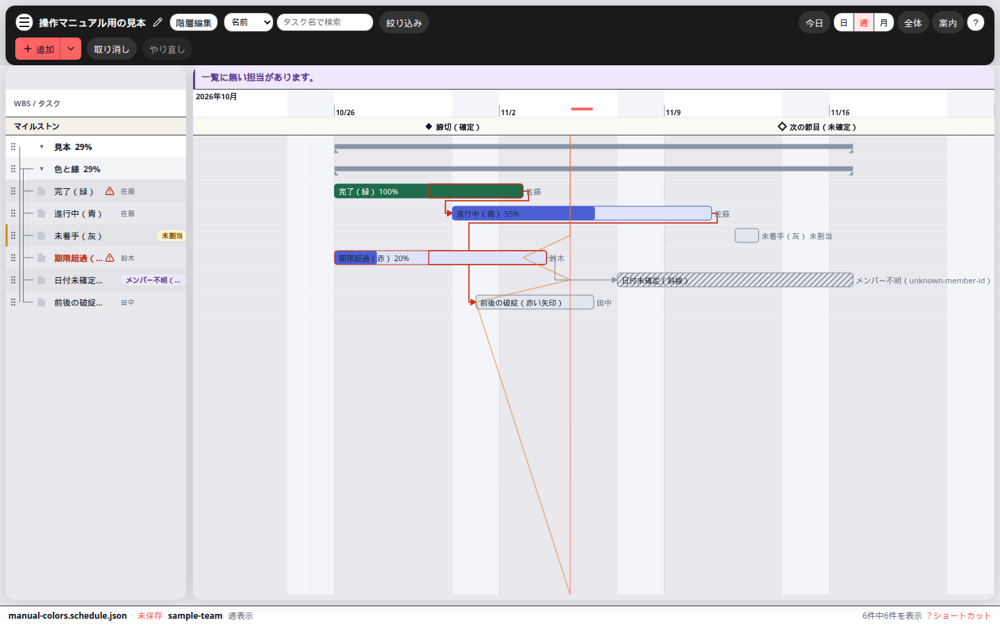
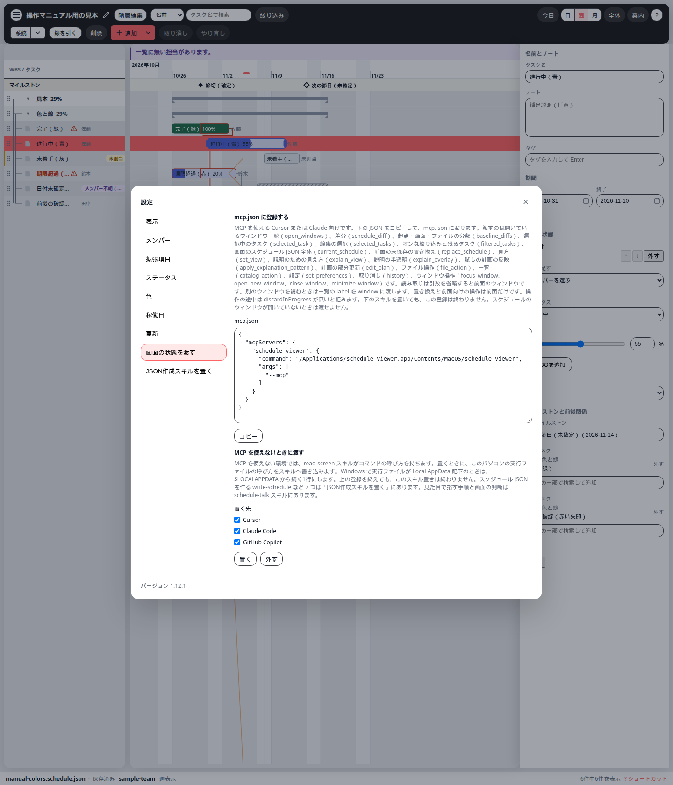

# はじめに

[操作マニュアル](../user-manual.md) の、使い始めるための短い手順です。

このアプリは、用意したスケジュール JSON を WBS とガントチャートとして表示します。絞り込みと、その場での修正も、このアプリの役割です。稼働日を数えて期間を出すことはしません。前後関係に合わせて日付を自動で動かすこともありません。アプリの中から LLM にスケジュールを作らせることもありません。

## 入手と起動

Ubuntu の安定版は [GitHub Releases](https://github.com/shkobayashi/schedule-viewer/releases) の Latest から入手します。Windows の安定版は [Microsoft Store](https://apps.microsoft.com/detail/9PP41TRJ8ZT8) から入手します。Pre-release は実機確認用であり、自動更新では届きません。GitHub の Release では配布物の SHA-256 を `SHA256SUMS` で確認できます。Ubuntu で Pre-release の deb を入れたあとに安定版へ移すときは、先に Pre-release の deb を外してください。

Ubuntu 22.04 以降で使うファイルは `schedule-viewer_X.Y.Z_amd64.deb` です。導入は `sudo apt install ./schedule-viewer_X.Y.Z_amd64.deb` で行います。起動コマンドは `schedule-viewer` です。Windows では Microsoft Store から schedule-viewer を入れ、スタートメニューから起動します。更新は Windows が行います。

Apple Silicon の Mac では、Latest の `schedule-viewer_X.Y.Z_aarch64.dmg` をダウンロードし、ディスクイメージを開いて schedule-viewer をアプリケーションフォルダへ入れます。dmg の中の .app からは起動しません。初回は Gatekeeper が止めることがあります。Release 本文の手順に従って開きます。

Intel Mac では、使う Mac の上でビルドする必要があります。手順の場所は [開発ガイド](../development.md#配布用ビルド) です。

ふだん使うのは、上の手順で入れるデスクトップ版です。ブラウザ版は開発中の確認用で、リポジトリで `npm run dev` を実行して開きます。ブラウザ版で違うのは、ファイルの開き方や保存のしかたです。違いは [全機能の「ブラウザ版とデスクトップ版の違い」](features.md#ブラウザ版とデスクトップ版の違い) にまとめてあります。

## 起動して見る



起動すると、デスクトップ版では前回のファイルが決まるまで、一覧とチャートの枠だけが見えます。決まったあとに、サンプルまたは前回の内容が一度だけ表示されます。初めて起動したときと、前回がサンプルのときは、サンプルが表示されます。サンプルの日付は、起動して画面に載せた時点の暦日を基準に作られます。アプリを開いたまま日付が変わっても、サンプルの日付は自動では作り直しません。

デスクトップ版でサンプルを開いた直後は、画面右下に **はじめての起動** のカードが出ます。見出しに **サンプルを表示しています** と出ます。3 つの項目を順に進められ、1 つ終えても消えず、すべて終えるか × で閉じるまで残ります。ファイルを開いたあとも、未完了の項目があればカードは残ります。項目は次のとおりです。

1. **スケジュールを用意する** — 「LLM で作る」と「ある JSON を開く」の 2 ボタン
2. **操作の案内を読む**
3. **LLM（MCP）とつなぐ**

カードの下には、保存のショートカットが 1 行で出ます。ブラウザ版は、起動直後からサンプルが表示されます。初回カードと保存ヒントのピルは出ません。

JSON を開いたあともカードが残るときは、見出しが **次の 3 つを終えましょう** に変わります。項目の意味は同じです。

左が名前の一覧で、右が時間軸です。上のツールバーと、画面下の状態バーが、一覧とチャートを挟んで並びます。上段の **案内**（正式名は操作の案内）、☰ の「操作の案内」、⌘ または Ctrl+K のコマンドパレットの「操作の案内」で、最初にやる 3 つ、開く・保存、画面の見方を短く読めます。起動時には出ません。

## 手で一か所直して保存する

サンプル以外の JSON を開くときは、☰ の **開く** で選びます。詳しい保存の流れは [全機能の「ファイルを開く・保存する」](features.md#ファイルを開く保存する) にあります。

サンプルのタスクを 1 件選び、チャートのバーを少し動かすか、右の詳細パネルで開始日や終了日を変えます。編集の詳細は [全機能の「編集する」](features.md#編集する) にあります。

保存は ☰ の **保存** か Ctrl+S（Mac では ⌘S）です。サンプルのままだと保存先が無いので、初めて保存するときは保存先を聞かれます。選んだパスに JSON ができ、次の保存はそのファイルへ上書きします。

デスクトップ版では、初めて未保存の編集をしたあと、状態バーに「保存は ☰ または ⌘S」（Windows と Linux では Ctrl+S）のヒントが出ます。一度保存に成功すると、同じ環境では出ません。状態バーの **未保存** から差分を開けます。

## LLM で一か所直す（デスクトップ版）

ここでは、すでに開いているサンプルを LLM に 1 か所だけ直してもらう流れです。JSON をゼロから作る流れは [チュートリアル](tutorial.md) にあります。

### スキルと MCP の準備

1. ☰ → **設定** → **JSON作成スキルを置く** で、Claude Code を選び、`schedule-talk` など 7 つのスキルを置きます（上書きの確認や外す操作は [全機能の「設定」](features.md#設定)）。
2. 同じ設定の **画面の状態を渡す** で、**mcp.json に登録する** の **コピー** を押します。成功すると「JSON をコピーしました。」と出ます。コピーされる JSON は、実行ファイルのパスと `"args": ["--mcp"]` だけです。設定から MCP プロセスは起動しません。スケジュールのウィンドウは開いたままにします。



### Claude Code に MCP を登録する

Claude Code のターミナル（`claude` セッションの外）で、コピーした実行ファイルのパスを `--` の後ろに置きます。全プロジェクトで使うときは `--scope user` を付けます。

```bash
claude mcp add --transport stdio schedule-viewer --scope user -- /path/to/schedule-viewer --mcp
```

成功すると `Added ...` と `File modified:` が出ます。失敗すると `was not saved` または `may not have been saved` と出ることがあります。

登録の確認は、ターミナルで `claude mcp get schedule-viewer`、Claude Code セッション内では `/mcp` です。接続できているときはツール数が表示されます。失敗すると `✘ Failed to connect` と `Issue:` が出ます。stdio が落ちたときは `/mcp` の Reconnect を試します。プロジェクト承認待ちのときは `⏸ Pending approval` と出ます。

アプリがコピーする JSON に `type` は付きません。Claude Code はそれを stdio サーバとして読みます。Cursor 向けに `mcpServers` ごと貼る形とは異なります。

### 依頼して、戻す

1. サンプルで直したいタスクを 1 件選びます。
2. Claude Code のチャットに **選んでいるタスクを 2 日後ろにずらして** と送ります。変更は未保存になります。
3. タスクが **2 件以上** 変わったときは、チャート上で変えた場所が半透明で示され、チャットでも何をなぜ変えたかが続きます。1 件だけのときは、説明するか LLM の判断です。
4. うまくいかなければ **やっぱり戻して** と頼み、取り消し 1 段で戻します。保存するか、取り消すかは人が選びます。

ほかの依頼例は [チュートリアルの「LLM に頼める例」](tutorial.md#llm-に頼める例) と、操作の案内の「もう少し知りたいとき」にあります。同じ 2 日ずらしの流れを詳しく読むときは [チュートリアルの「チャットで 2 日ずらしてみる」](tutorial.md#チャットで-2-日ずらしてみる) へ進んでください。

## 初回の案内を閉じたあと

カードを × または Escape で閉じると、同じ環境では再び出ません。チェックと閉じた記録は PC に残ります。そのあと次の入口を使います。

| やりたいこと | 入口 |
| --- | --- |
| 操作を短く読む | 上段の **案内**、☰ の「操作の案内」 |
| キーを調べる | ? キー、F1、画面下の「? ショートカット」、☰ の「ショートカット一覧」 |
| 保存する | ☰ の「保存」、Ctrl+S（Mac では ⌘S）、状態バーの保存ヒント（初回未保存時） |
| 差分を見る | 状態バーの **未保存**、☰ の「差分を表示」 |
| MCP とスキル | ☰ → **設定** の「画面の状態を渡す」「JSON作成スキルを置く」 |
| 目的から探す | [やりたいことから探す](find-by-intent.md)、[全機能](features.md) |
| JSON を LLM で作る流れ | [チュートリアル](tutorial.md) |

☰ の「開く」「別名保存」、書き出し、設定のほかの項目は [全機能の「ファイルを開く・保存する」](features.md#ファイルを開く保存する) と [設定](features.md#設定) にあります。

## 次に読む文書

- [やりたいことから探す](find-by-intent.md) — 全機能の見出しへ飛ぶ索引
- [チュートリアル](tutorial.md) — スキルで JSON を作り、MCP で取り込み直す
- [全機能](features.md) — 絞り込み、編集、設定、ショートカット、困ったとき
